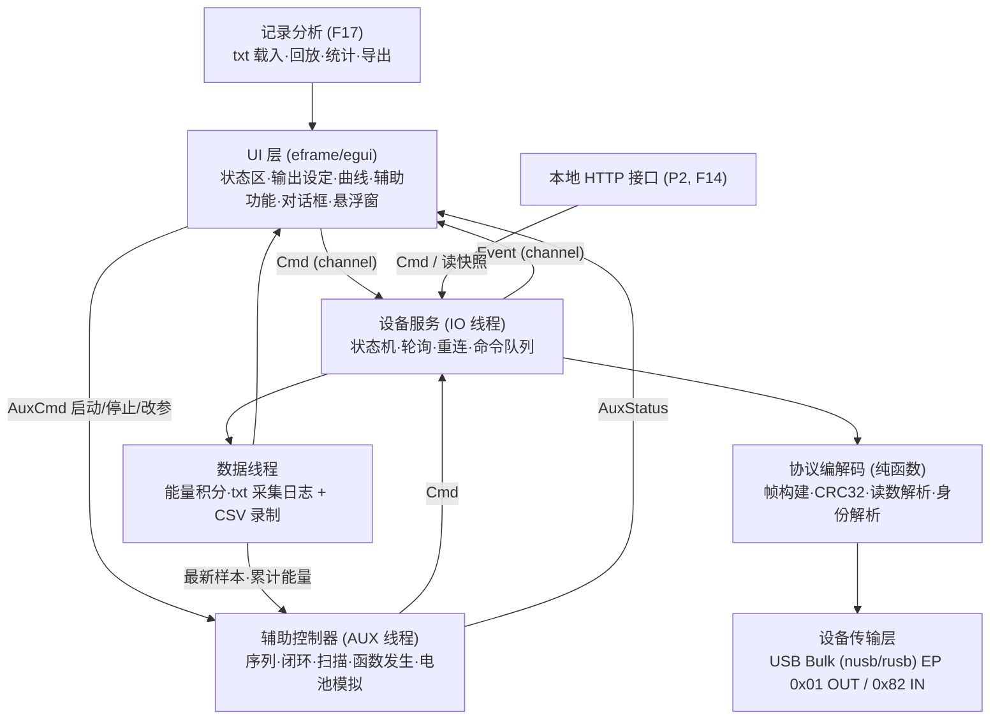

# 架构设计

> 依据 [PRD.md](PRD.md)、[Communication/协议文档.md](Communication/协议文档.md)。界面细节见 [界面设计.md](界面设计.md)。

## 1. 分层


| 层 | 职责 | 依赖 |
|---|---|---|
| 设备传输层 | 枚举 VID 0x0408/PID 0x1043、打开、claim 接口 0、Bulk 读写（写超时 `usb_timeout_ms`，读应答超时见 §4.1）、release | `nusb`（纯 Rust，首选）或 `rusb`（libusb） |
| 协议编解码层 | `build_frame`、`frame_connect/poll/set_vi/output`、`parse_measurement`、`parse_identity`；无 IO，可单测 | `crc32fast` |
| 设备服务 | 独立 IO 线程，状态机、轮询节拍、命令合并与节流、错误分类与重连 | crossbeam-channel |
| 数据线程 | 连接期间常驻：能量/平均功率积分（含不受「清空」影响的累计能量）、发布最新样本快照、录制时写 txt 采集日志与 CSV（F05/F17） | `csv` |
| 辅助控制器 | 独立 AUX 线程，按各功能执行频率定时推进序列/闭环/扫描/函数发生器/电池模拟，只通过 `Cmd` 下发；不依赖 UI 刷新，窗口最小化也照常运行 | crossbeam-channel |
| 记录分析 | 解析 txt 采集日志、区间统计、事件列表、导出 CSV（F17） | — |
| UI 层 | 渲染、用户输入、设定值模型（编辑值/设备设定，[详细设计 §2.6](详细设计.md#26-设定值模型编辑值与设备设定)）、输入校验（validate_setpoint）、曲线环形缓冲与区间统计、设置持久化 | eframe、egui_plot、rfd、serde_json |

## 2. crate 目录结构
单 crate 起步，协议层独立为 workspace 成员以便单测与复用（如 CLI / HTTP）。
```
IOT_Power/
├─ Cargo.toml                 # workspace
├─ Doc/                       # 本文档集；Doc/Communication/协议文档.md
├─ crates/
│  ├─ dc3005u-proto/          # 协议编解码（无 IO）
│  │  ├─ src/lib.rs  frame.rs  measurement.rs  identity.rs
│  │  └─ tests/samples/       # poll_*.bin 样本
│  └─ dc3005u-usb/            # 传输层 + 设备服务线程
│     └─ src/lib.rs  transport.rs  worker.rs
├─ app/                       # 上位机 GUI (bin: iot-power)
│  ├─ assets/ (font.ttf, icon.ico, Li-ion.csv, OFL.txt)
│  └─ src/
│     ├─ main.rs  app.rs  config.rs  i18n.rs  theme.rs
│     ├─ data/ (worker.rs 数据线程, buffer.rs, energy.rs, recorder.rs, txtlog.rs, analysis.rs, stats.rs)
│     ├─ setpoint.rs          # 设定值模型：编辑值 / 设备设定 / 待确认
│     ├─ aux/ (worker.rs AUX 线程, preset.rs, sequence.rs, keep_power.rs, sweep.rs, wavegen.rs, battery.rs)
│     ├─ ui/ (status_panel.rs, output_panel.rs, graph_panel.rs, aux_tabs.rs,
│     │       power_dialog.rs, graphics_dialog.rs, floating.rs, result_window.rs, analysis_window.rs,
│     │       widgets/{digit_spin.rs, lcd.rs, range_slider.rs})
│     └─ http.rs              # P2，feature = "http"
└─ packaging/ (nsis/, deb/, docker/, 99-dc3005u.rules)
```

## 3. 关键数据结构（Rust 伪代码）
```rust
pub const VID: u16 = 0x0408;
pub const PID: u16 = 0x1043;
pub const EP_OUT: u8 = 0x01;
pub const EP_IN: u8 = 0x82;
pub const POLL_RESP_LEN: usize = 10072;          // 约值，按实际读取长度处理

/// 硬件极限：固定，写死在协议层（dc3005u-proto），用户不能改
pub const HW_V: RangeInclusive<f32> = 0.8..=24.0;
pub const HW_I: RangeInclusive<f32> = 0.5..=5.0;

/// 安全边界（F16）：用户在硬件极限内设置的工作范围，默认 = 硬件极限
#[derive(Clone, Copy, Serialize, Deserialize)]
pub struct SafetyLimits { pub v_min: f32, pub v_max: f32, pub i_min: f32, pub i_max: f32 }

#[derive(Debug)]
pub enum LimitError {
    OutOfHw   { field: Field, min: f32, max: f32 },        // 如「电压上限须在 0.8~24 V 内」
    Order     { qty: Qty },                                // 下限 > 上限
    OutOfSafety { field: Field, value: f32, min: f32, max: f32 }, // 设定值超出安全边界
    NotFinite { field: Field },                            // NaN / inf / 无法解析
}

impl SafetyLimits {
    /// 第 1 层：设置安全边界时校验；返回所有错误，UI 逐框标红；任一错误则不保存
    pub fn validate(&self) -> Result<(), Vec<LimitError>> { /* 每值 ∈ HW_*，且 min ≤ max */ }
}

/// 第 2 层：所有设定来源调用；超界返回 Err，调用方拒绝并提示，不下发
/// 比较前先四舍五入到 mV / mA 整数，边界本身也按 0.001 存储，避免 f32 误差（如 0.7996 V → 800 mV 合法）
/// v、i 是用户看到的值（显示修正之前）；显示修正后的下发值另按 HW_* 校验（详细设计 §5 第 2 条）
pub fn validate_setpoint(v: f32, i: f32, lim: &SafetyLimits) -> Result<(), Vec<LimitError>>;

/// 仅用于 AUX 运行中的瞬时值（闭环/函数发生器/电池模拟）；返回是否发生钳位，调用方每次运行只告警一次
pub fn clamp_to_limits(v: f32, i: f32, lim: &SafetyLimits) -> (f32, f32, bool);

/// 最后一道保险：IO 线程编码 0x03 前调用；按 HW_* 钳位（显示修正关闭时同时按安全边界钳位），触发即 log::error!
fn guard_before_send(volt_mv: u16, amp_ma: u16, lim: &SafetyLimits, cali_on: bool) -> (u16, u16);

pub fn build_frame(body: &[u8]) -> Vec<u8> {      // 0x55 | body | 0xAA | CRC32_LE(0x55..0xAA)
    let mut f = vec![0x55]; f.extend_from_slice(body); f.push(0xAA);
    let crc = crc32fast::hash(&f); f.extend_from_slice(&crc.to_le_bytes()); f
}
pub fn frame_connect() -> Vec<u8> { build_frame(&[0x01, 0x00]) }
pub fn frame_poll()    -> Vec<u8> { build_frame(&[0x05, 0x00]) }
pub fn frame_output(on: bool) -> Vec<u8> { build_frame(&[0x06, 0x04, on as u8, 0, 0, 0]) }
/// 协议 v0.4 §4.3（已确定）：参数 4 字节 = voltage_mV(u16 LE) | current_limit_mA(u16 LE)
/// 例：24 V / 1 A → 03 04 C0 5D E8 03
pub fn frame_set_vi(voltage_mv: u16, current_ma: u16) -> Vec<u8> {
    let mut b = vec![0x03, 0x04];
    b.extend_from_slice(&voltage_mv.to_le_bytes());    // 低 16 位 = 电压，mV
    b.extend_from_slice(&current_ma.to_le_bytes());    // 高 16 位 = 限流，mA
    build_frame(&b)
}
/// 换算已确定：分辨率 1 mV / 1 mA，四舍五入
pub fn volt_to_mv(v: f32) -> u16 { (v * 1000.0).round() as u16 }
pub fn amp_to_ma(a: f32)  -> u16 { (a * 1000.0).round() as u16 }

pub struct Identity { pub model: String, pub serial: String, pub firmware: String } // 按 \0 分隔解析

pub struct Measurement {
    pub seq: u32,                 // @16
    pub voltage_v: f32,           // u16@30 / 1000
    pub current_ma: f64,          // u32@20 / 100000，分辨率 10 nA
    pub power_dev_w: f64,         // u32@24 / 1e8，设备回报，仅调试/校验；u32 最大只能表示 42.95 W，>40 W 时不可信；界面功率用 V×I
    pub set_voltage_mv: u16,      // @52 电压设定回显，mV
    pub set_current_ma: u16,      // @54 限流回显，mA
    pub t: Instant,               // 主机时间戳
}

pub enum Source { Manual, QuickSet, Preset, OnPrepare /*ON 前先下发设定*/, Seq, Aux, Http, EStop, Exit }

pub enum Cmd {
    Connect, Disconnect,
    SetVI { id: CmdId, volt_mv: u16, amp_ma: u16, source: Source }, // 已做显示修正与换算；调用方已校验；IO 线程 guard_before_send 兜底
    Output { id: CmdId, on: bool, source: Source },
    SetPollInterval(Duration),
    EStop,                          // 清空待发设定，当前事务结束后立刻发送 0x06 00（见 §4.1）
                                    // 重连中的 Output{on:false} 记为 pending_off，重连后先发
    Shutdown,
}
pub enum Event {
    State(LinkState),
    Identity(Identity),
    Sample(Measurement),            // 重复帧（序号与上一帧相同）不发
    Error(DeviceError),
    CmdResult { id: CmdId, cmd: u8, source: Source, result: Result<Ack, CmdError> }, // 每条命令的应答确认结果
    SetpointEcho { volt_mv: u16, amp_ma: u16 },    // @52/@54 回显，UI 侧按 §2.6 规则同步设备设定
    PendingOff(bool),               // 有未完成的关输出请求（OFF 失败 / 断线期间急停），重连后优先发送
}
pub enum Ack {
    Acked,                          // 收到应答
    Confirmed,                      // 读数回显已确认（仅 0x03）
    Superseded,                     // 确认前已有更新的 0x03 发出，本条不再确认，不算失败
}
pub enum CmdError { Timeout, BadResponse(String), Usb(String), EchoMismatch }
/// 界面上的输出状态（设备不回读输出状态，只能这样表示可信度）
pub enum OutputView {
    Acked(bool),                    // 本次连接内最后一条 0x06 已应答
    Stale(bool),                    // 断线 / 重连后还没有再发过 0x06：保持原值，标「状态未经设备确认」
    Unknown,                        // 从未得知（off_on_connect=false）或关输出失败
}
pub enum LinkState { Disconnected, Connecting { waiting_device: bool }, Connected, Reconnecting { attempt: u32 } }
pub enum DeviceError { NotFound, Busy /*claim 失败*/, Permission, Timeout, ShortFrame(usize), Io(String) }
pub enum LinkOrigin { FirstConnect /*启动自动连接或手动点连接*/, Reconnect }
```

## 4. 线程模型
- **UI 线程**：eframe 主循环；渲染、用户输入、设定值模型、曲线环形缓冲与区间统计。启动 AUX 前的交互（参数校验、输出开启警告确认）在 UI 线程完成，确认后发 `AuxCmd::Start` 给 AUX 线程。
- **AUX 线程**（1 个）：同一时刻最多运行一个高级功能；用 `crossbeam_channel::select!` + 超时实现定时（到下一个 tick 或下一个序列到期时刻），定时精度约 ±2 ms，不依赖 UI 刷新（eframe 在窗口最小化时可能不调用 `update`）。读数据线程发布的最新样本和累计能量，下发走 `Cmd`，状态（当前步、SOC、钳位次数、下发失败次数）通过 `AuxStatus` 通道回报 UI。
- **IO 线程**（1 个）：独占 USB 句柄，按 §4.1 的请求-应答规则**严格串行**执行事务。循环：取下一条待执行命令（优先级 `EStop`/pending_off > `Output` > `SetVI`（只保留最新一条，两次间隔 ≥ `setpoint_min_interval_ms`）> 到点的 `0x05`）→ 一次事务 → 发 `Event`。
- **轮询节拍**：固定节拍，第 n 次轮询的计划时刻 = t0 + n × `poll_interval_ms`；某次事务超时导致错过的节拍直接跳过，不补发；样本时间戳取应答读完的时刻。界面显示的「实际采样率」按相邻有效样本时间差计算。
- **数据线程**：连接期间常驻（与是否录制无关）。IO 线程把每个样本经**无界**通道送来（不丢样本）；数据线程完成能量积分、更新最新样本快照（`Arc<RwLock<Snapshot>>`，供 AUX 与 HTTP 读），录制时写 txt 采集日志与 CSV，避免磁盘 IO 阻塞 IO 线程；txt 每 1 s flush、每 5 s fsync，CSV 每 30 s flush（F05/F17）。
- **HTTP 线程**（P2）：`tiny_http`/`axum`，读最新样本快照，写操作转成 `Cmd`。
- 通道：`Cmd` 用 `crossbeam_channel::unbounded`；IO → 数据线程无界；IO → UI 的绘图/显示通道有界（容量 4096，约 200 s 的 50 ms 样本），只有 UI 卡死这么久才会丢最旧样本。丢样本时：录制文件和能量积分不受影响；曲线缓冲与区间统计缺这些样本，丢弃数显示在缓冲占用旁。

### 4.1 命令请求-应答规则（每条命令都要确认）
| 项 | 规则 |
|---|---|
| 配对 | 一次事务 = 写一帧到 EP 0x01 → 在 EP 0x82 读应答直到短包或读满。**一个命令未应答（或超时判定失败）前，不发下一个命令**；应答按 FIFO 与刚发出的命令配对。 |
| 写前排空 | 每次写之前用 10 ms 超时读一次 IN 端点，丢弃残留数据并计数（防止上一事务的迟到应答造成错位）。 |
| 超时（默认，均待实测调整） | `0x05`：`resp_timeout_poll_ms` = 500；`0x01`/`0x03`/`0x06`：`resp_timeout_cmd_ms` = 300；写超时 = `usb_timeout_ms`（2000）。 |
| 重试 | 所有命令（`0x01`/`0x03`/`0x05`/`0x06`）超时或应答无效时重试 `cmd_retries` 次（默认 2，即共 3 次）；`0x03`、`0x06` 是幂等命令，可安全重发。`0x05` 重试用尽后按 §5 走 `0x01` / 重连。急停与 pending_off 固定重试 5 次，不受 `cmd_retries` 影响。 |
| 应答校验 | ① 若应答以 `0x55` 开头：要求含 `0xAA` + 4 字节 CRC32 且 CRC 正确、命令字与请求相同，否则视为无效；② 协议文档 §6 指出读数帧是裸二进制（无 55/AA/CRC），因此 `0x05` 应答按长度校验（≥56 字节）；帧序号 @16 与上一帧**相同**时视为重复帧：事务算成功、样本丢弃（不进缓冲、不积分、不录制）并计数，不重试；连续 1 s 都是重复帧按读超时处理（[PRD §8](PRD.md#8-待确认) #10）；③ `0x01`：长度 ≈63 字节且含可见 ASCII 视为身份帧，长度 ≥56 且像读数帧（协议 §4.1「已连接时返回读数类数据」）则按读数解析、身份沿用上次；④ `0x03`/`0x06` 的短应答内容（长度、是否带状态码）**未知，待实测**：目前任何在超时内收到的非空应答都算「已应答」，实测出状态码格式后再加严。 |
| 生效确认 | `0x03`：收到应答后，在接下来 2 次有效 `0x05` 读数里比对 @52（mV）/@54（mA）回显与下发的整数值，**任一次**一致 → `Ack::Confirmed`；两次都不一致 → `CmdError::EchoMismatch`；确认完成前又发出了新的 `0x03` → 本条记 `Ack::Superseded`（不算失败，只确认最新一条）。`0x06`：读数帧里没有已标定的输出状态，**只能确认到「已应答」**（`OutputView::Acked`）。 |
| 失败处理与回滚 | 按来源区分：**手动/快速设定/预设/HTTP** 设定失败（超时/无效/回显不符）→ 设定框编辑值恢复为设备设定（[详细设计 §2.6](详细设计.md#26-设定值模型编辑值与设备设定)），toast「设定未生效：{原因}」，事件写入 txt 日志；**AUX/序列** 设定失败不回滚、不逐条弹 toast，只累计「下发失败 N 次」显示在 AUX 页，连续 3 次失败则停止该 AUX 并提示一次。ON 失败 → 按钮保持 OFF，提示「打开输出失败」；OFF 失败 → `OutputView::Unknown`（红），横幅「关闭输出失败，请手动关闭设备输出」，并置 pending_off，每 1 s 继续重试 `0x06 00` 直到成功或用户断开。**连续 3 条** `0x01`/`0x03`/`0x06` 命令失败（每条都已重试用尽，仅 `Timeout`/`BadResponse`/`Usb` 计入，`EchoMismatch` 不计入）→ 进入 `Reconnecting`。 |
| 急停 | `EStop` 不打断正在进行的 USB 传输（打断会导致应答错位）：清空所有待发命令，当前事务一结束（最长 = 当前超时）就发 `0x06 00`，失败最多重试 5 次，期间不发 `0x05`；全部失败时置 pending_off 并红色横幅提示手动关输出。 |
| pending_off | 有未完成的「关输出」意图（OFF 失败、急停失败、重连中点了 OFF）时置位，界面提示「已记录关输出请求，重连后立即执行」（重连中）。已连接时每 1 s 重试 `0x06 00`；**重连成功后第一条命令就是 `0x06 00`**（这是用户已发出的关输出请求，不违反「重连不动输出」）。成功后清除；用户点断开时清除并保留横幅。 |
| 统计 | 每类命令记录成功数、超时数、无效应答数、平均往返时间，在电源设置里显示（用于实测调参）。 |

## 5. 错误处理与重连
| 情况 | 处理 |
|---|---|
| 找不到设备 | 手动连接：`NotFound`，提示检查线缆 / 驱动 / Windows 设备是否被禁用；启动自动连接：停在「连接中（等待设备…）」每 1 s 枚举一次，直到找到或用户点断开 |
| 序列号与上次不同 | 照常连接，提示「已连接设备序列号与上次不同」，更新 `device_serial`（不支持多设备选择，有多台时连第一台） |
| claim 失败 | `Busy`，提示关闭官方 IoT Power 软件 |
| Linux 打开失败 EACCES | `Permission`，提示安装 udev 规则 |
| 读超时 | 按 §4.1 重试 `0x05`（`cmd_retries` 次）；仍失败 → 发 `0x01`；再失败 → `Reconnecting` |
| 设备拔出 | 进入 `Reconnecting`，每 1 s 枚举一次，找到后重新 claim + `0x01` |
| 短帧 / 无效应答 | 丢弃并计数，按 §4.1 重试，不中断轮询 |
| 用户断开 | release 接口，停止轮询（协议无断开命令） |

**首次连接**（程序启动后的自动连接或用户手动点「连接」，`LinkOrigin::FirstConnect`）成功后，默认先发一次 `0x06 00`（`off_on_connect`，默认开）。**自动重连**（`LinkOrigin::Reconnect`）成功后**不主动发** `0x06`、不重发设定（唯一例外：pending_off 置位时先发 `0x06 00`，见 §4.1）：界面输出状态变为 `OutputView::Stale`（保持断线前的值，标注「状态未经设备确认」）；用 @52/@54 回显按 [详细设计 §2.6](详细设计.md#26-设定值模型编辑值与设备设定) 同步设备设定；录制继续写入同一文件（txt 记事件 `LINK restored`）。从「错误」状态点重试、或断开后再点连接，都算首次连接。

设定值检查三层：① 设置安全边界时 `SafetyLimits::validate`（硬件极限内、下限 ≤ 上限，不合法不保存）；② 所有设定来源下发前 `validate_setpoint`，超界拒绝（只有 AUX 运行中的瞬时值走 `clamp_to_limits` 并告警）；显示修正开启时，修正后的下发值再按 `HW_*` 校验，超出则拒绝；③ IO 线程收到 `SetVI` 后 `guard_before_send` 兜底钳位（`SafetyLimits` 为 `Arc<RwLock<_>>`，只在输出确定为关时允许写），正常不触发，触发记 error 日志。

## 6. 配置存储
- `settings.json`（serde），位置：Windows `%APPDATA%\IOT_Power\`，Linux `~/.config/iot_power/`（`directories` crate）。
- 内容：轮询间隔（50~65535 ms，默认 50）、应答超时、安全边界 `safety.{v_min,v_max,i_min,i_max}`、连接时关输出、电流单位、主题、语言、刷新率、记录点数、插值、置零阈值、显示修正 k/b、预设组、输出警告/锁定、窗口尺寸、txt 采集日志设置（`log_*`）、HTTP 开关/token/`http_allow_output_on`。完整字段表见 [详细设计.md](详细设计.md#32-settingsjson)。
- 读失败用默认值并提示；写入先写临时文件再 rename。

## 7. 本地 HTTP 接口（P2，F14）
默认关闭；仅绑定 `127.0.0.1`；请求需 `Authorization: Bearer <token>`；不返回任何 CORS 头并校验 `Host` 为 `127.0.0.1:<port>`/`localhost:<port>`（防浏览器跨站和 DNS rebinding）；token 随机生成、明文存于 settings.json（文件权限仅当前用户可读）。开启后状态栏常驻「远程控制中」。
| 方法 | 路径 | 说明 |
|---|---|---|
| GET | `/api/status` | 连接状态、身份、最新 V/I/P、输出状态及是否经设备确认 |
| POST | `/api/setpoint` | `{"volt":5.0,"amp":1.0}`（amp = 限流）；超出安全边界 `400 {error, field, min, max}`；锁定或 AUX 运行中 `409`；不下发 |
| POST | `/api/output` | `{"on":true}`：关输出总是允许（AUX 运行中等同急停，先停 AUX）；开输出需设置里勾选「允许远程打开输出」（`http_allow_output_on`，默认不勾），否则 `403`；AUX 运行中 `409`（输出锁定的约束体现在 `/api/setpoint`：输出开且锁定时写设定一律 `409`）；当前设定超出安全边界 `400`；远程开输出**不弹确认框**（无人值守需要），写 txt 事件 `src=http` |
| GET | `/api/samples?since=<n>` | 增量样本；`n` 是上位机自己的样本计数（连接以来单调递增，不用设备帧序号，避免设备重启后序号回绕），最多返回最近 10000 个 |

## 8. 待确认
统一清单见 [PRD.md §8](PRD.md#8-待确认)。
