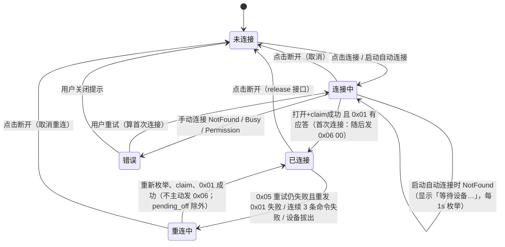
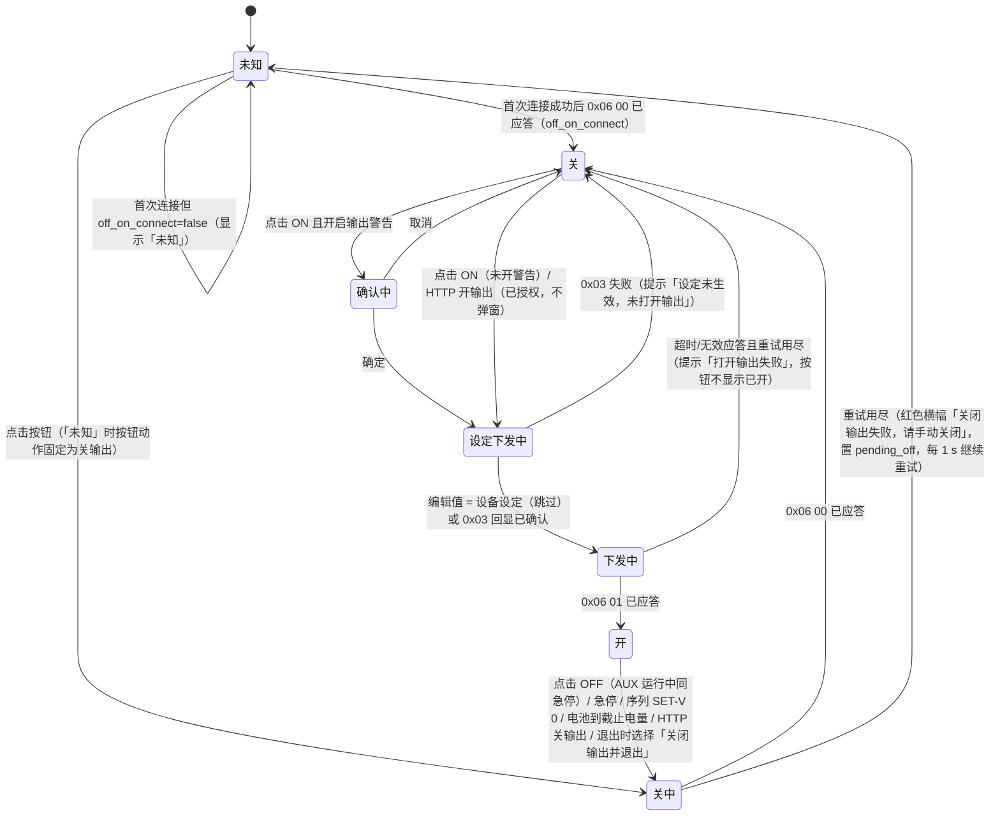
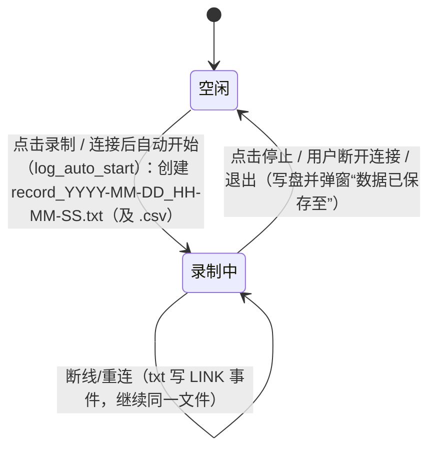
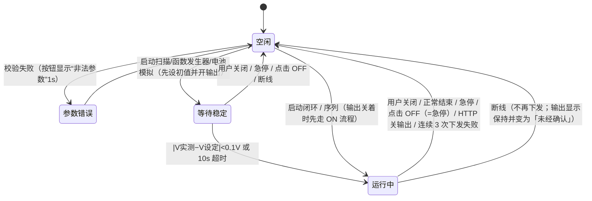

# 详细设计

> 版本 0.1.0 · 2026-10-10
> GUI 与功能：以 [pd_pocket_pc_controller](https://github.com/ElluIFX/pd_pocket_pc_controller) master 源码为准（`gui_source/mdp_gui.py`、`mdp_gui_template/{mainwindow,settings,graphics}.ui`、`en_US.ts`）。
> 通信：只用 [Communication/协议文档.md](Communication/协议文档.md) 里有的命令：`0x01` 连接、`0x05` 读数、`0x03` 设定电压（mV）+ 限流（mA）、`0x06` 输出开关。不新增命令。
> 编号沿用 [PRD.md](PRD.md)（F01~F17），命名沿用 [界面设计.md](界面设计.md)，线程和 Cmd/Event 定义见 [架构设计.md](架构设计.md)。

## 0. 约定

| 标记 | 含义 |
|---|---|
| **照搬** | 原控件和逻辑原样实现，最多换成 egui 写法 |
| **上位机** | 原版依赖 PD Pocket 的串口命令或推流，DC3005U 上改为由上位机计算，或用 `0x03`/`0x05`/`0x06` 组合实现 |

DC3005U 和原 PD Pocket 的关键差异（影响下文所有设计）：

1. **设定是打包的**：`0x03` 一次同时下发电压和限流（参数 4 字节 = 电压 u16 mV | 限流 u16 mA，小端；协议 v0.4 已确定），所以改电压或改限流都要发「最新 V + 最新 I」。设定分辨率 1 mV / 1 mA。
2. **设定下限**：电压 0.8~24 V，电流 0.5~5.0 A。原版很多地方写 `v_set = 0`（序列 `SET-V 0`、功率闭环在输出关闭时、电池模拟启动时），这些在 DC3005U 上一律改为「发 `0x06 00` 关输出，设定值保持最近一次的合法值」，**任何时候都不下发低于安全边界下限（至少 0.8 V / 限流 0.5 A）的值**。
3. **没有推流**：原版发 `getmsg <ms>` 让设备主动推数据；DC3005U 由 IO 线程按「轮询间隔」循环发 `0x05`。
4. **输出状态读不回来**：原版从推流帧的 `state` 字段读输出状态；DC3005U 读数帧里没有已标定的输出状态字段（偏移 32–51 未标定），所以上位机按三级可信度显示输出状态（`OutputView`，见 [PRD §8](PRD.md#8-待确认) #3）：
   - **已应答**：本次连接内最后一条 `0x06` 已应答，按它显示 ON/OFF；按钮旁灰色 ⓘ，悬停说明「设备不回读输出状态，以最后一次已应答的命令为准」。
   - **未经确认**：断线 / 重连后还没再发过 `0x06`，保持断线前的值，按钮加黄色边框并显示「状态未经设备确认」。
   - **未知**：从未得知（`off_on_connect`=false）或关输出失败，按钮显示红色「未知」。
5. **设定回显**：读数帧 @52 回显电压设定（mV）、@54 回显限流（mA）。用途：① 确认 `0x03` 已生效（架构设计 §4.1）；② 代替原版 `get vset/iset` 得到「设备设定」，规则见 §2.6。
6. **每条命令都读应答**：IO 线程严格「请求 → 应答 → 下一条」，超时、重试、校验、失败回滚见 [架构设计 §4.1](架构设计.md#41-命令请求-应答规则每条命令都要确认)。

### 0.1 术语：硬件极限与安全边界
| 术语 | 含义 | 值 | 能否修改 |
|---|---|---|---|
| **硬件极限** | DC3005U 允许的设定范围 | 电压 `HW_V` 0.8~24 V，电流 `HW_I` 0.5~5.0 A | 固定，写死在协议层常量里，用户不能改 |
| **安全边界** | 用户在硬件极限之内自定的工作范围（F16） | `safety.v_min/v_max/i_min/i_max` | 可改，默认等于硬件极限；只能在输出关闭时改 |

| **限流** | `0x03` 里的电流设定 = 输出电流上限（CC 限流点），界面和文案统一称「限流」 | 0.5~5.0 A，1 mA 分辨率 | 用户设定 |
| **测量电流** | 读数帧 u32@20 实测电流，与限流无关，可小到 µA 级 | 分辨率 10 nA | 只读 |

所有设定值都必须在**安全边界**内；安全边界本身必须在**硬件极限**内。限流下限 0.5 A 只是「最多允许流过多少电流」的下限，被测设备实际只取 µA 也照样能测。

## 1. 功能对照总表

原版页面：MW = 主窗口，TAB-x = 辅助功能 Tab，DS = 电源设置对话框（settings.ui），DG = 图形设置对话框（graphics.ui），FW = 悬浮窗，RW = 结果曲线窗。

| # | 原控件 / 功能 | 所在页面 | 分类 | F 编号 | 协议命令 | 说明 |
|---|---|---|---|---|---|---|
| 1 | `btnConnect` 连接/断开 | MW 左下 | 上位机 | F01 | `0x01` | 原版：开串口 → `getmsg 0` → `MEAS:POW?` → `get vset/iset` → `getmsg <ms>`。新版：按 VID/PID 打开 USB → claim → `0x01` 握手并解析身份 → 开始 `0x05` 轮询 |
| 2 | `labelConnectState` 未连接/已连接 | MW 左下 | 照搬 | F01 | — | 增加「连接中」「重连中」「错误」三个状态（见 §2.1） |
| 3 | 标题栏型号/版本 | MW 标题 | 上位机 | F01 | `0x01` | 用握手解析出的型号、序列号、固件版本 |
| 4 | 自动找串口失败时弹出串口列表 | MW 弹窗 | 上位机 | F01 | — | 改为提示「未找到 DC3005U（VID 0408 / PID 1043）」，并给出驱动/权限排查方法 |
| 5 | `lcdVoltage` 电压 (V) | MW 状态区 | 照搬 | F02 | `0x05` | 数据源换成读数帧 u16@30/1000 |
| 6 | `lcdCurrent` 电流 (A) | MW 状态区 | 上位机 | F02 | `0x05` | u32@20/100000 得到 mA（分辨率 10 nA）；新版自动量程 A/mA/µA（§3.6），原版固定 A |
| 7 | `lcdPower` 功率 (W) | MW 状态区 | 上位机 | F02 | `0x05` | **确定用主机计算 V̄×Ī**（与原版一致）；设备回报功率 u32@24/1e8 只用于调试和校验（见 §3.6） |
| 8 | `lcdEnerge` 能量 (J) | MW 状态区 | 照搬 | F02 | — | Σ V·I·dt，dt 为相邻样本的主机时间差；断线时段不计（§3.6） |
| 9 | `lcdAvgPower` 平均功率 | MW 状态区 | 照搬 | F02 | — | 本次输出开启以来的能量 ÷ 开启时长（扣除断线）；输出关闭时为 0；曲线「保持」时冻结显示 |
| 10 | `lcdResistence` 负载阻值 | MW 状态区 | 上位机 | F02 | — | 原版 Ī < 2 mA 显示「--」；新版按 §3.6 规则：Ī=0 显示「∞」，R > 10 MΩ 显示「--」，否则自动量程 Ω/kΩ/MΩ |
| 11 | 插值位数 / 置零阈值 / 读数显示修正 | MW 状态区 + DG | 照搬 | F02/F08 | — | 小数位 = 3+interp；低于阈值置 0；y=kx+b |
| 12 | `btnOutput`「- ON -/- OFF -/[N/A]」 | MW 输出设定 | 上位机 | F03 | `0x06` | 原版颜色跟随推流里的 state；新版按三级可信度显示（已应答 / 未经确认 / 未知，见 §0 第 4 条）；ON 前若编辑值与设备设定不同先下发设定（§5 第 1 条） |
| 13 | `spinBoxVoltage` 设定电压 | MW 输出设定 | 上位机 | F03 | `0x03` | 原版范围 0~36 V、2 位小数；新版 0.8~24 V、3 位小数，下发时打包当前电流 |
| 14 | `spinBoxCurrent` 限流（原「设定电流」） | MW 输出设定 | 上位机 | F03 | `0x03` | 原版 0~5.5 A；新版 0.5~5.0 A（mA 下发，3 位小数），打包当前电压 |
| 15 | `checkBoxQuickset` 快速设定 | MW 输出设定 | 照搬 | F03 | `0x03` | 值一变就提交；新版加节流（§4.0） |
| 16 | 按位更改 / 自由更改（`set_step`） | MW 输出设定 + DG | 照搬 | F03/F08 | — | 按位：光标所在位决定步进（整数位 1，小数第 1 位 0.1，第 2 位 0.01，第 3 位 0.001；原版只有 2 位小数）；自由：自适应步进 |
| 17 | `progressBarVoltage/Current` | MW 输出设定 | 照搬 | F03 | — | 实测/设定 ×1000，上限 1000 |
| 18 | `get vset/iset` 同步设定值 | MW（连接时） | 上位机 | F03 | `0x05` | 用读数帧 @52（mV）/@54（mA）回显代替：确认设定生效、得到「设备设定」并按 §2.6 同步设定框 |
| 19 | `comboGraph1Data/2Data` 上/下窗口数据 | MW 曲线 | 照搬 | F04 | — | 电压/电流/功率/阻值/无 |
| 20 | `doubleSpinBoxSampleRate` 采样间隔 (ms) | MW 曲线 | 上位机 | F04 | `0x05` | 原版 2~65535 ms，默认 50，用 `getmsg` 下发；新版为 `0x05` 轮询间隔，默认 50 ms，下限 50 ms（实测后再调） |
| 21 | `labelFps` 实时采样率 | MW 曲线 | 照搬 | F04 | — | FPSCounter：最近 40 个间隔做平滑 |
| 22 | `btnGraphRecord` 录制/停止 | MW 曲线 | 照搬 | F05 | — | 30 s 自动存盘；格式见 §3.1 |
| 23 | `btnGraphDump` 导出 | MW 曲线 | 照搬 | F05 | — | 导出缓冲区，5 列 |
| 24 | `btnGraphAutoScale` 适应/手动 | MW 曲线 | 照搬 | F04 | — | 手动时允许鼠标缩放，禁用区间滑块 |
| 25 | `btnGraphKeep` 保持/解除 | MW 曲线 | 照搬 | F04 | — | 冻结画面、锁定数据下拉框，缓冲区继续更新 |
| 26 | `btnGraphClear` 清空 | MW 曲线 | 照搬 | F04 | — | 先弹窗确认 |
| 27 | `btnRecordFloatWindow` 浮窗 | MW 曲线 | 照搬 | F09 | — | — |
| 28 | `btnRecordClear` 回零 | MW 曲线工具栏 | 照搬 | F02 | — | 清零能量和平均功率 |
| 29 | `labelBufferSize` 缓冲占用 | MW 曲线 | 照搬 | F04 | — | 超过 95% 变黄 |
| 30 | `horizontalSlider` 区间滑块 + `labelDisplayRange` | MW 曲线 | 照搬 | F04 | — | 最小跨度 = display_pts，拖到最右为跟随，两端拉满为全览 |
| 31 | `labelGraphInfo` 统计 | MW 曲线 | 照搬 | F04 | — | `Vavg/Vmax/Vmin/Vpp`，两图用「 \| 」分隔 |
| 32 | `pushButtonLastTab/NextTab` + `labelTab` + 滚轮切换 | MW 辅助功能 | 照搬 | — | — | 只有连接后才能用滚轮切换 |
| 33 | `comboPreset` 选择预设 | TAB-预设组 | 上位机 | F06 | `0x03` | 选中后同时下发 V 和 I（一帧），然后下拉框回到「[>] 选择预设」 |
| 34 | `comboPresetEdit` + 电压/电流 + `btnPresetSave` | TAB-预设组 | 照搬 | F06 | — | 范围改为 0.8~24 V / 0.5~5.0 A |
| 35 | `btnKeepPower` 功率闭环开关 | TAB-功率闭环 | 上位机 | F10 | `0x03`/`0x05` | §4.1 |
| 36 | 目标功率 / 闭环参数 / 电压上限 / 执行频率 | TAB-功率闭环 | 上位机 | F10 | — | 电压上限范围改为 0.8~24 V |
| 37 | `btnSweep` 直流扫描开关 | TAB-直流扫描 | 上位机 | F11 | `0x03`/`0x05` | §4.2 |
| 38 | 目标参数 / 起始点 / 结束点 / 步进值 / 延迟 / 扫描响应 | TAB-直流扫描 | 上位机 | F11 | — | 范围按 0.8~24 V / 0.5~5.0 A |
| 39 | `btnSweepShowRecord` 查看响应曲线 | TAB-直流扫描 | 照搬 | F11 | — | 打开 RW |
| 40 | `btnWaveGen` 函数发生器开关 | TAB-函数发生器 | 上位机 | F12 | `0x03` | §4.3 |
| 41 | 波形类型 / 周期 / 高电平 / 低电平 / 执行频率 | TAB-函数发生器 | 上位机 | F12 | — | 高/低电平范围 0.8~24 V |
| 42 | `listSeq` 序列列表 + 右键（编辑/删除/清空）+ 双击编辑 | TAB-序列执行 | 照搬 | F07 | — | — |
| 43 | `btnSeqDelay/WaitTime/Voltage/Current` 添加动作 | TAB-序列执行 | 照搬 | F07 | — | 电压/限流输入框范围为当前安全边界（SET-V 另允许 0） |
| 44 | `btnSeqSave/Load` 保存/载入 | TAB-序列执行 | 照搬 | F07 | — | 格式见 §3.4，修复原版 WAIT 行载入失败的问题 |
| 45 | `btnSeqSingle/Loop/Stop` 单次/循环/停止 | TAB-序列执行 | 上位机 | F07 | `0x03`/`0x06` | §4.4 |
| 46 | `btnBatSim` 电池模拟开关 | TAB-电池模拟 | 上位机 | F13 | `0x03`/`0x06` | §4.5 |
| 47 | 加载曲线 / 查看曲线 / 放电曲线下拉 | TAB-电池模拟 | 照搬 | F13 | — | 内置 Li-ion.csv |
| 48 | 当前电量 / 截止电量 / 单节容量 / 单节内阻 / 多节串联 / 执行频率 / 放电时长 | TAB-电池模拟 | 上位机 | F13 | — | 串联数 1~6 保留，但 OCV×S 超过 24 V 时拒绝启动 |
| 49 | `btnGraphics` 图形设置 | MW 左下 | 照搬 | F08 | — | — |
| 50 | `btnSettings` 电源设置 | MW 左下 | 照搬 | F08 | — | — |
| 51 | `comboBoxPort` 串口号（自动/枚举） | DS 连接设置 | 上位机 | F01/F08 | — | 删除串口选择：多设备不在范围内，始终连第一台 0408:1043；连接后显示序列号，与上次（`device_serial`）不同时提示 |
| 52 | `spinBoxBaud` 波特率 | DS 连接设置 | 上位机 | F08 | — | USB Bulk 没有波特率；该位置换成「轮询间隔」「读写超时」「启动时自动连接」 |
| 58 | `checkBoxOutputWarn` 输出开启警告 | DS 其它设置 | 照搬 | F03 | — | — |
| 59 | `checkBoxSetLock` 输出时锁定参数 | DS 其它设置 | 照搬 | F03 | — | 包括辅助功能和预设 |
| 60 | `comboTheme` 界面主题（暗黑/明亮/自定义） | DG UI 设置 | 照搬 | F08 | — | — |
| 61 | `comboInput` 输入方式 | DG UI 设置 | 照搬 | F08 | — | — |
| 62 | `spinMaxFps` 图表最大刷新率 | DG 图表设置 | 照搬 | F04/F08 | — | — |
| 63 | `spinDataLength` 记录点数 / `spinDisplayLength` 最小显示点数 | DG 图表设置 | 照搬 | F04/F08 | — | 修改记录点数会清空缓冲区 |
| 64 | `checkBoxOpenGL` OpenGL 加速 / `labelNumba` | DG 图表设置 | 上位机 | F08 | — | egui 本身走 GPU 渲染，这两个不需要；位置换成「曲线降采样」开关 |
| 65 | `checkBoxAntialias` 曲线抗锯齿 | DG 图表设置 | 照搬 | F08 | — | 对应 egui 的 feathering |
| 66 | `spinStateFps` 状态区刷新率 / `comboInterp` 插值方式 | DG 状态区设置 | 照搬 | F02/F08 | — | — |
| 67 | `spinStateVThres/IThres` 置零阈值 | DG 状态区设置 | 照搬 | F02/F08 | — | — |
| 68 | `checkBoxUseCali` + 读数 Vk/Vb/Ik/Ib + 设定 Vk/Vb/Ik/Ib | DG 显示修正 | 照搬 | F08 | — | 纯上位机线性修正（新版改名为「显示修正」）；规则见 §5 第 2 条：安全边界校验用户看到的值，修正后的下发值再校验硬件极限 |
| 69 | 悬浮窗 U/I/P、拖动、双击折叠、滚轮调透明度、右键折叠/展开/关闭 | FW | 照搬 | F09 | — | 75×140 px，折叠后高 80 px |
| 70 | 结果窗：曲线、X/Y 交换、多项式拟合次数 0~8、RMSE、当前点十字线 | RW | 照搬 | F11/F13 | — | §4.6 |
| 71 | 启动参数 `--english` / 环境变量 `MDP_FORCE_ENGLISH` / 系统语言 | 启动 | 照搬 | F15 | — | 新版另外在 DG 里加语言切换 |
| 72 | `MDP_ENABLE_LOG` / `--debug` 日志 | 启动 | 照搬 | — | — | 用 `RUST_LOG` 或 `--debug` |
| 73 | 无边框窗口 + 自绘标题栏（qframelesswindow） | 全部窗口 | 上位机 | — | — | 默认用系统边框，自绘标题栏放到 P2 |
| 76 | 安全边界（新增，原版无） | DS 安全边界 | 上位机 | F16 | `0x03` | 用户在硬件极限内设电压/限流上下限；所有设定来源先按边界校验，超界拒绝（§4.0、§5.2） |
| 77 | txt 采集日志与记录分析（新增，原版无） | MW 曲线工具栏 + 分析窗口 | 上位机 | F17 | — | §3.7；分析窗口见界面设计 §3.4 |

**统计**：照搬 43 条，上位机 27 条，共 70 条（原编号 1~75 保持原样，其中 53~57、74、75 已移除，见 §1.1；76、77 为新版新增）。

### 1.1 已移除（设备无此功能）
经确认 DC3005U 没有以下功能，原版对应控件、配色、设置字段和文案在新版中全部删除，不做界面：

| 原编号 | 原版功能 | 原控件 |
|---|---|---|
| 53 | 最大输出功率 | `btnSetMaxP` + `spinBoxMaxP` |
| 54 | 输出校准 | `btnCali1` |
| 55 | 输入校准 | `btnCali2` |
| 56 | 短路保护 | `btnEnableShortProtect` / `btnDisableShortProtect` |
| 57 | 按键锁 | `btnLockKey` / `btnUnlockKey` |
| 74 | CV/CC 状态 | 主题键 `cv` / `cc` |
| 75 | 输入电压 | 原协议字段 `vinput` |

## 2. 状态机

### 2.1 连接

- 「首次连接」= 程序启动后的自动连接、用户手动点「连接」、或从「错误」状态重试；「重连」= 已连接后因断线由程序自动恢复，不限次数，每 1 s 一次，只能由用户点「断开」结束。只有首次连接会自动关一次输出（`off_on_connect`）。
- 进入「重连中」时：停止所有高级功能（原版 `stopMyTimer` 也会停掉全部辅助定时器和录制），待发命令清空（pending_off 保留）；**录制不停止**：断线期间没有样本，txt 日志写事件 `LINK lost`，CSV 不写行；输出状态变为「未经确认」（保持断线前的值）。
- 重连成功后**不主动发 `0x06`、不自动开输出、不重发设定**；唯一例外是 pending_off（断线前未成功的关输出 / 急停，或重连中点了 OFF），此时第一条命令就是 `0x06 00`。txt 写 `LINK restored`，录制继续写同一文件；用 @52/@54 回显按 §2.6 同步设备设定。
- 「重连中」点断开：录制停止并写盘（与「已连接」时断开一致）。

### 2.2 输出

- 「首次连接时关输出」**确定为默认行为**（`off_on_connect`，默认 true）：输出状态读不回来，首次连接主动发一次 `0x06 00` 让界面与设备一致；关掉此项时首次连接后显示「未知」。**重连不关输出**，避免 USB 抖动打断长时间测试。
- 图中「开」「关」都有两种可信度（§0 第 4 条）：本次连接内 `0x06` 已应答为「已应答」；断线 / 重连后为「未经确认」，直到下一条 `0x06` 已应答。「未经确认」时按钮照常可点（ON→OFF、OFF→ON）。
- 「输出可能为开」= 开（任一可信度）或未知。安全边界修改、退出确认、输出时锁定参数都按「输出可能为开」判断。

### 2.3 录制


### 2.4 高级功能
序列、扫描、闭环、函数发生器、电池模拟统称 **AUX**，**同一时刻最多运行一个**（原版没有做互斥，几个定时器可以同时写 v_set；新版强制互斥）。

- AUX 运行中 ON/OFF 按钮只能点 OFF，效果等同急停；ON 不可用（输出由 AUX 自己管理）。唯一会在运行中关输出而不停止 AUX 的是序列自身的 `SET-V 0`。
- 启动时的交互（参数校验、输出开启警告确认）在 UI 线程完成，确认后交给 AUX 线程执行（[架构设计 §4](架构设计.md#4-线程模型)），窗口最小化不影响运行。

### 2.5 状态 × 控件可用性
✓ 可用，✗ 禁用，— 不适用。「AUX 运行」指任一高级功能处于等待稳定或运行中。「输出开」列指「输出可能为开」（开的任一可信度，或未知，见 §2.2）。

| 控件 | 未连接 | 连接中/重连中 | 已连接·输出关 | 已连接·输出开 | 输出开+锁定参数 | AUX 运行 |
|---|---|---|---|---|---|---|
| 连接/断开 | ✓(连接) | ✓(取消/断开) | ✓ | ✓ | ✓ | ✓（断开会先急停） |
| ON/OFF 按钮 | ✗（显示 [N/A]） | 连接中✗；重连中保持显示断线前状态，输出可能为开时只有 OFF ✓（置 pending_off，重连后立即执行） | ✓ | ✓（「未知」时按钮动作为关输出） | ✓ | 只有 OFF ✓（等于急停），ON ✗ |
| 设定电压 | ✓（可编辑，不下发；连接后也不自动下发，标「未提交」，见 §2.6） | ✓（同左） | ✓ | ✓ | ✗ | ✗（整块禁用，显示 AUX 下发的设备设定，见互斥规则 2） |
| 限流 | ✓（同上） | ✓（同上） | ✓ | ✓ | ✗ | 同上 |
| 快速设定 | ✗ | ✗ | ✓ | ✓ | ✗ | ✗ |
| 预设选择 | ✗ | ✗ | ✓ | ✓ | ✗ | ✗ |
| 预设编辑/保存 | ✓ | ✓ | ✓ | ✓ | ✓ | ✓ |
| 曲线工具栏（录制/导出/适应/保持/清空/浮窗/回零） | 导出✓（缓冲有数据时） 其它✗ | 连接中全✗；重连中只有「停止录制」✓（不能开始新录制） | ✓ | ✓ | ✓ | ✓ |
| 采样间隔 | ✗ | ✗ | ✓ | ✓ | ✓ | ✓ |
| 区间滑块 | ✗ | ✗ | 样本数 > display_pts+5 时 ✓；手动或保持时 ✗ | 同左 | 同左 | 同左 |
| Tab 切换 ◀▶/滚轮 | ◀▶✓ 滚轮✗ | 同左 | ✓ | ✓ | ✓ | ✓ |
| AUX 启动按钮 | ✗ | ✗ | ✓ | ✓ | ✗ | 正在运行的那个✓（关闭），其它✗ |
| AUX 参数 | ✓ | ✓ | ✓ | ✓ | ✓ | 运行中的那个按原版规则：扫描整页✗；闭环只锁执行频率（目标/Ki/电压上限可在线改，改动同样经安全边界校验，超界标红不生效、保留旧值）；函数发生器只锁执行频率（类型/周期/高低电平在线生效，高低电平同样校验）；电池模拟除「查看曲线」外全锁；序列隐藏编辑按钮、只显示停止 |
| 电源设置 | ✓ | ✓ | ✓ | ✓ | ✓ | ✓ |
| 安全边界（电源设置内，F16） | ✓ | 输出显示为关时✓，开或未知时✗ | ✓ | ✗（置灰，提示「请先关闭输出再修改安全边界」） | ✗（同左） | ✗（AUX 运行时禁止修改） |
| 安全边界 [确定] | 四值合法时✓ | 同左 | 同左 | ✗ | ✗ | ✗ |
| 设定框超界（标红）时的 ON 按钮 | — | — | ✗（提示先调整设定） | 不适用（输出开时无法改边界，手动超界值不下发） | — | — |
| AUX 启动按钮（参数超界时） | ✗ | ✗ | ✗，旁边列出超界参数 | ✗ | ✗ | — |
| 图形设置 | ✓ | ✓ | ✓ | ✓ | ✓ | ✓（改记录点数会清空缓冲，AUX 运行时禁止改） |
| 记录分析窗口（F17） | ✓ | ✓ | ✓ | ✓ | ✓ | ✓（只读，不影响设备） |

**互斥规则**
1. AUX 互斥：启动一个时，其它 AUX 的启动按钮禁用。
2. AUX 运行时，手动设定框、快速设定、预设选择都禁用（原版只禁被接管的那一个框，新版扩大到整块，避免手动值和 AUX 打架）。
3. 「输出时锁定参数」开启且输出可能为开时，禁止**用户发起**的设定修改：手动、快速设定、预设、HTTP，以及 AUX **启动**（与原版 `checkBoxSetLock` 的提示「包括辅助功能」一致）。在输出关闭时已启动的 AUX，自己开了输出之后照常下发（来源 `Seq`/`Aux` 不受锁定限制），否则序列、扫描、函数发生器、电池模拟在锁定开启时根本无法运行。
4. 正在录制时可以断开，断开会先写盘。
5. 保持（HOLD）时锁定上下图数据下拉框（原版行为）。
6. 安全边界只能在输出确定为关（已应答或未经确认的「关」）且没有 AUX 运行时修改。改窄后如果当前编辑值或设备设定已超出新边界：弹窗提示「当前设定值超出新的安全边界，请调整」，设定框标红；**不自动修改**，在调整到边界内之前 ON 按钮禁用、快速设定不提交。程序启动时从 settings 恢复的 `last_vset`/`last_iset` 若超出当前安全边界，同样标红并禁用 ON。设备回显（例如在设备面板上改的设定）超出安全边界时同样标红、禁用 ON，并提示「设备当前设定超出安全边界」。

### 2.6 设定值模型：编辑值与设备设定
电压、限流各有两份值，界面上分开显示：

| 值 | 含义 | 显示 |
|---|---|---|
| **编辑值** | 设定框里的数字，用户正在编辑或准备提交的值 | 设定框本身；与设备设定不同时框旁显示「未提交」 |
| **设备设定** | 设备当前的设定：最近一次回显确认的 `0x03`，或 @52/@54 回显同步得到的值（已做显示修正的反算，见 §5 第 2 条） | 设定框下方小字「设备 5.000 V / 2.000 A」；未连接时显示「—」 |

规则：
1. **提交**：回车、离开输入框、或快速设定下值变化，都提交编辑值；编辑值和设备设定相同时不下发。提交只改一个量时，另一个量取**设备设定**打包下发（不取另一个框里未提交的编辑值）。
2. **确认成功**：设备设定 = 下发值，「未提交」消失。**失败**：编辑值恢复为设备设定，toast「设定未生效：{原因}」。
3. **回显同步**：没有待确认的 `0x03` 时，回显与设备设定不同（设备面板上改了设定、重连后等）→ 更新设备设定并写 txt 事件 `SETPOINT src=device`。此时如果编辑值没有未提交的修改且输入框不在编辑中，编辑值跟着更新；否则保留编辑值，只提示「设备设定已变为 {v} V / {i} A，你的编辑未提交」。
4. **首次连接**：第一个有效读数的回显作为设备设定。连接前编辑过（未提交）的值保留并标「未提交」；没编辑过的，编辑值直接取设备设定（启动时从 `last_vset`/`last_iset` 恢复的值只在未连接时显示）。
5. **点 ON**：两个编辑值都必须在安全边界内；若与设备设定不同，先按规则 1 下发并等回显确认，确认后再发 `0x06 01`（§2.2「设定下发中」）。输出开启警告的确认框显示即将生效的编辑值。
6. **AUX 运行中**：设定框禁用，编辑值随设备设定实时更新，不显示「未提交」。
7. **保存**：退出时把编辑值存为 `last_vset`/`last_iset`。

## 3. 数据设计

### 3.1 CSV
原版有两种 CSV，新版保持列名与单位完全一致，方便沿用原有分析脚本；新增列放到最后。

一次「录制」同时生成两种文件，共用同一采样流和数据线程：**txt 采集日志**（F17，主格式，含事件，可在分析窗口载入，见 §3.7）和 **CSV**（F05，列与原版兼容，方便沿用原有脚本；`record_csv` 默认 true，可关）。二者并存而不合并，理由：CSV 必须保持原版列结构才能被老脚本读取，塞不下事件行和文件头；txt 不受这个约束，可以记录完整上下文。

**录制文件（F05，`btnGraphRecord`）**
- 文件名：`record_YYYY-MM-DD_HH-MM-SS.csv`（本地时间）。原版放在程序目录（`ARG_PATH`）；新版默认放 `录制目录`（settings `record_dir`，默认为用户「文档/IOT_Power」），可在设置中改。
- 原版表头 `time/s,voltage/V,current/A`，`%f` 格式（6 位小数），逗号分隔，无注释行。
- 新版表头：

| 列 | 单位 | 说明 |
|---|---|---|
| `time/s` | s | 相对录制开始的主机单调时间（原版：第一样本只记起点不写行，从第二个样本开始写；新版从第一个样本写，time=0） |
| `voltage/V` | V | 显示修正、置零阈值处理之后的值（与原版一致） |
| `current/A` | A | 同上，由 mA ÷ 1000 得到；**固定 8 位小数**（1e-8 A = 10 nA，等于协议分辨率） |
| `power/W` | W | **新增**：主机计算 V×I，8 位小数 |
| `seq` | — | **新增**：读数帧序号 u32@16，用于判断丢帧 |
| `power_dev/W` | W | **新增，调试列**：设备回报功率 u32@24/1e8，8 位小数；仅在设置 `debug_columns=true` 时写入（默认不写） |

- 数值格式：`time/s`、`voltage/V` 保持原版 6 位小数（电压分辨率 1 mV）；`current/A`、`power/W`、`power_dev/W` 用 8 位小数。原版 `%f` 只有 6 位（1 µA），µA 级测量会丢精度，所以新版加长；列名不变，原版脚本照样能读。

- 落盘：原版每 30 s 把整份内存数据**重写**整个文件（录制越久越慢）；新版改为每 30 s **追加** flush，停止时再 flush 一次。
- 分文件：跟随 txt 一起切（txt 因时长或大小任一条件切文件时，CSV 同时切），文件名同 txt：`…_part2.csv`、`…_part3.csv`；每个分文件都写表头；`time/s` 沿用录制起点，不归零。
- 数值是显示修正之后的值；修正参数写在同次 txt 的文件头里（`# cali=`），需要原始值时可反算。
- 在原版里录制不受图形缓冲区限制（内存中无限增长）；新版直接流式写盘，内存只留 30 s 的待写数据。

**导出文件（F05，`btnGraphDump`）**
- 默认文件名：原版 `pd_pocket_buffer_dump.csv` → 新版 `iot_power_buffer_dump.csv`。
- 表头（与原版一致）：`time/s,voltage/V,current/A,power/W,resistance/ohm`。`time/s`/`voltage/V` 6 位小数，`current/A`/`power/W` 8 位小数，`resistance/ohm` 用 `%.6g`。`time/s` 相对缓冲区起点（连接或清空的时刻）；`power/W` 为 V×I；电流为 0 时 `resistance/ohm` 写 `inf`（原版写开路标记值 `open_r`）。

### 3.2 settings.json
- 位置：Windows `%APPDATA%\IOT_Power\settings.json`，Linux `~/.config/iot_power/settings.json`（原版放程序目录）。
- 规则：`safety` 读入后逐项检查，任一值超出硬件极限或下限 > 上限，则四个值全部恢复为硬件极限并提示（不做部分钳位）；读入后缺失的字段补默认值；越界的值钳位到范围内并写 warn 日志；未知字段保留（与原版 `__dict__.update` 行为兼容）；退出时和每次关闭设置对话框时保存（与原版一致），先写临时文件再 rename。

| 字段 | 类型 | 默认 | 范围 | 来源 / 说明 |
|---|---|---|---|---|
| `presets` | map<"1".."9", [f32 V, f32 A]> | 见 §3.3 | V 0.8~24，A 0.5~5.0 | 原版，默认值调整 |
| `baudrate` | — | — | — | 原版字段，**删除**（USB 无波特率），读到就忽略 |
| `comport` | — | — | — | 原版字段，**删除**；由 `device_serial` 代替 |
| `device_serial` | string | `""` | — | 新增：上次连接的设备序列号（握手返回），只用于连接后比对，不同时提示；不用于选设备 |
| `poll_interval_ms` | u32 | 50 | 50~65535（下限 50 ms，实测后再调；读到更小值按 50 处理） | 对应原版 `data_ms`（原版不保存，每次 50）；新版保存 |
| `usb_timeout_ms` | u32 | 2000 | 500~5000 | 新增：写超时，协议建议 1~3 s |
| `resp_timeout_poll_ms` | u32 | 500 | 100~5000 | 新增：`0x05` 应答超时（待实测调整） |
| `resp_timeout_cmd_ms` | u32 | 300 | 50~5000 | 新增：`0x01`/`0x03`/`0x06` 应答超时（待实测调整） |
| `cmd_retries` | u8 | 2 | 0~5 | 新增：`0x01`/`0x03`/`0x05`/`0x06` 超时或无效应答后的重试次数（急停固定 5 次，不受此项影响） |
| `auto_connect` | bool | false | — | 新增 |
| `off_on_connect` | bool | true | — | 新增：**首次连接**成功后下发 `0x06 00`（已确定为默认行为）；重连不发 |
| `safety.v_min` | f32 | 0.8 | 硬件极限 0.8~24，≤ v_max | 新增（F16）：安全边界电压下限；不合法不保存 |
| `safety.v_max` | f32 | 24.0 | 0.8~24，≥ v_min | 新增（F16）：安全边界电压上限 |
| `safety.i_min` | f32 | 0.5 | 0.5~5.0，≤ i_max | 新增（F16）：安全边界电流下限 |
| `safety.i_max` | f32 | 5.0 | 0.5~5.0，≥ i_min | 新增（F16）：安全边界电流上限 |
| `seq_oob_action` | string | `"stop"` | stop/skip | 新增（F16）：序列执行到超出安全边界的行时停止（默认）或跳过 |
| `current_unit` | string | `"auto"` | auto/A/mA/µA | 新增：状态区电流显示单位，auto = 自动量程 |
| `debug_columns` | bool | false | — | 新增：录制 CSV 是否附加 `power_dev/W` 调试列 |
| `setpoint_min_interval_ms` | u32 | 100 | 50~1000（实测后再调） | 新增：两次 `0x03` 的最小间隔 |
| `data_pts` | u32 | 100000 | 100~1000000 | 原版：记录点数（原版上限 10000000；新版每点 48 B，上限 100 万点约 48 MB，见 PRD 非功能需求） |
| `display_pts` | u32 | 400 | 100~`data_pts` | 原版：最小显示点数 |
| `graph_max_fps` | f32 | 50 | 1~120 | 原版 |
| `state_fps` | f32 | 10 | 1~120 | 原版 |
| `interp` | u8 | 0 | 0~3 | 原版：插值位数 |
| `opengl` | — | — | — | 原版字段，**删除** |
| `downsample` | bool | true | — | 新增：绘图时按像素做 min/max 降采样 |
| `antialias` | bool | true | — | 原版 |
| `bitadjust` | bool | false | — | 原版：true = 按位更改，false = 自由更改 |
| `last_vset` | f32 | 5.0 | 0.8~24 | 原版：退出时保存的编辑值，只在未连接时显示，**连接时不自动下发**，连接后按 §2.6 规则 4 处理 |
| `last_iset` | f32 | 2.0 | 0.5~5.0 | 原版（限流），同上；启动时超出安全边界则标红 |
| `v_threshold` | f32 | 0.002 | 0~1 V | 原版 |
| `i_threshold` | f32 | **0**（关闭） | 0~1 A | 原版默认 0.002；DC3005U 能测到 µA 级（分辨率 10 nA），新版默认 0，不置零 |
| `use_cali` | bool | false | — | 原版 |
| `v_cali_k` / `v_cali_b` | f64 | 1.0 / 0.0 | −100~100 | 原版：读数电压修正 |
| `i_cali_k` / `i_cali_b` | f64 | 1.0 / 0.0 | −100~100 | 原版：读数电流修正 |
| `vset_cali_k` / `vset_cali_b` | f64 | 1.0 / 0.0 | −100~100（k ≠ 0） | 原版：设定电压修正，下发值 = k × 编辑值 + b；编辑值按安全边界校验，下发值按硬件极限校验（§5 第 2 条） |
| `iset_cali_k` / `iset_cali_b` | f64 | 1.0 / 0.0 | −100~100（k ≠ 0） | 原版：限流设定修正，规则同上 |
| `output_warning` | bool | false | — | 原版 |
| `lock_when_output` | bool | false | — | 原版 |
| `theme` | string | `"dark"` | `dark`/`light`/自定义主题名 | 原版 |
| `color_palette` | map<主题, map<键, 颜色>> | 见 [界面设计.md](界面设计.md#4-配色) | CSS 颜色名或 `default` | 原版，键：off/on/lcd_voltage/lcd_current/lcd_power/lcd_energy/lcd_avg_power/lcd_resistance/general_green/general_red/general_yellow/general_blue/line1/line2；自定义主题用 `based_on_dark_or_light` 继承 |
| `language` | string | `"auto"` | auto/zh/en | 新增（原版只能靠启动参数） |
| `record_dir` | string | 文档/IOT_Power | 合法目录 | 新增：txt 与 CSV 录制目录 |
| `record_csv` | bool | true | — | 新增：录制时是否同时写 CSV |
| `log_auto_start` | bool | false | — | 新增（F17）：连接成功后自动开始录制 |
| `log_split_minutes` | u32 | 60 | 0~1440（0=不按时长分） | 新增（F17）：txt/CSV 按时长分文件 |
| `log_split_mb` | u32 | 100 | 0~2048（0=不按大小分） | 新增（F17）：txt 按大小分文件 |
| `log_flush_ms` | u32 | 1000 | 200~10000 | 新增（F17）：txt 写盘间隔（崩溃最多丢这么久） |
| `aux` | object | 见下 | — | 新增：记住各 AUX 页参数（原版不保存） |
| `http_enabled` / `http_port` / `http_token` | bool / u16 / string | false / 17321 / 随机生成 | 端口 1024~65535 | 新增，F14（P2）；默认关闭 |
| `http_allow_output_on` | bool | false | — | 新增，F14：是否允许 HTTP 打开输出（关输出总是允许） |
| `window` | {w,h,x,y} | 920×800 居中 | — | 原版启动固定 920×800 |

`aux` 子字段的默认值都取自原版 .ui：`keep_power {target_w:1.0(原 0，0 W 会把电压一路压到下限，新版要求 > 0), ki:2.5, max_v:24.0(原30), freq_hz:10(原30)}`、`sweep {target:"voltage", start:1.0, stop:5.0, step:0.1, delay_s:1.0(原 .ui 无 value，即最小值 0.1，新版取 1.0), response:"none"}`、`wavegen {type:"square", period_s:1.0, high_v:5.0, low_v:2.0, freq_hz:10(原30)}`、`batsim {curve:"Li-ion", soc_now:100, soc_stop:0, cap_wh:10, r_mohm:0, cells:1, freq_hz:10(原30)}`。执行频率默认从 30 Hz 降到 10 Hz，原因是 `0x03` 能多快连续下发还不知道（[PRD §8](PRD.md#8-待确认) #1）。settings 里没有 `aux` 字段（首次运行或删过配置）时，上述电压/电流类默认值先截取到当前安全边界内再填入（例如边界 3~12 V 时闭环电压上限默认 12 V、扫描起点默认 3 V）；已保存的参数不自动修改，超界照常标红、不能启动。

### 3.3 预设组
- 存在 `settings.json` 的 `presets` 里，键 "1"~"9"，值 `[电压V, 电流A]`（与原版一致）。
- 下拉框显示格式与原版一致：第 0 项 `[>] 选择预设`（不可选），之后形如 `[1] 03.300V 02.000A`，即 `format!("[{k}] {v:06.3}V {i:06.3}A")`。编辑下拉显示 `Preset-k`。
- 默认值（原 8:24V/10A、9:30V/10A 超出 DC3005U 范围，已调整）：

| 编号 | 1 | 2 | 3 | 4 | 5 | 6 | 7 | 8 | 9 |
|---|---|---|---|---|---|---|---|---|---|
| 电压 V | 3.3 | 3.3 | 5 | 5 | 9 | 12 | 20 | 24 | 24 |
| 电流 A | 2 | 5 | 2 | 5 | 5 | 5 | 5 | 3 | 5 |

- settings.json 里旧预设值超出硬件极限时（如原版 30 V / 10 A），载入时修正为硬件极限并提示一次（属于配置迁移，不是下发；修正后仍可能超出安全边界，按下一条处理）。
- 超出**安全边界**的预设：下拉框里该项文字标红并加「⚠ 超出安全边界」提示；选中时**拒绝应用**，提示「预设 {n} 超出安全边界：{field} 允许 {min}~{max}」，不下发。编辑框保存时只校验硬件极限（不要求在安全边界内），以免改窄边界后预设丢失。

### 3.4 序列文件（.txt，UTF-8）
每行一个动作，和原版列表项文本完全一致：

| 动作 | 行格式 | 范围 | 执行语义（DC3005U） |
|---|---|---|---|
| 延迟 | `DELAY <整数> ms` | 0~100000 | 从进入这一步开始计时，等够时长 |
| 等待 | `WAIT  yyyy-MM-dd HH:mm:ss`（WAIT 后两个空格） | 本地时间 | 等到这个时刻；已经过了就立即继续 |
| 电压 | `SET-V <x.xxx> V` | 0 或 0.8~24 | 0 → 下发 `0x06 00` 关输出（不发 0 V 设定）；非 0 → 下发 `0x03`（当前 I + 新 V），输出关着时再发 `0x06 01` |
| 电流 | `SET-I <x.xxx> A` | 0.5~5.0 | 下发 `0x03`（新 I + 当前 V） |

- 载入校验：原版按单空格 `split(" ")` 后要求恰好 3 段，`WAIT  日期 时间` 会被切成 4 段，所以**原版保存的 WAIT 行无法再载入**（原版 bug）。新版改为按空白切分（`split_whitespace`）：WAIT 要求 3 段且能解析日期时间，其它要求 3 段、单位匹配、数值能解析且在范围内。保存时仍写两个空格，与原版文件互通。
- 校验失败：弹窗「数据验证错误: <该行>」，整份文件不载入（与原版一致）。这里的「在范围内」指硬件极限（0 或 0.8~24 V、0.5~5.0 A）。
- 超出**安全边界**但在硬件极限内的行：照常载入，列表里标红并加提示；执行到这一行时**拒绝下发**，按 `seq_oob_action` 停止（默认）或跳过并记录警告。在列表里新增/编辑动作时，输入范围为当前安全边界（`SET-V 0` 表示关输出，不受边界影响）。
- 注释：新版允许 `#` 开头的行和空行，载入时跳过（原版不支持，新版保存时不写注释，保证原版也能读）。

### 3.5 曲线缓冲
- 环形缓冲，容量 `data_pts`（默认 100000，上限 1000000），位于 UI 线程。每个样本存 `t: f64, v: f32, i: f64, p_calc: f64, p_dev: f32, r: f64, seq: u32`，共 48 字节，默认约 4.8 MB。电流、功率、阻值用 f64：f32 只有约 7 位有效数字，5 A 量程下分辨不出 10 nA（原版 5 个 f64 数组，40 B/点，满了以后每次都用 `np.roll` 整体移位；新版环形缓冲没有移位开销）。
- 阻值在电流为 0 时存 `+inf`，绘图和统计时跳过非有限值（原版用 `open_r` 哨兵值再过滤）。
- 显示窗口：`display_pts`（默认 400）是最小跨度；跟随模式显示最新 N 点；全览模式（滑块两端拉满）显示全部。超过屏幕宽度像素数时按像素做 min/max 降采样。
- 统计（avg/max/min/pp）只在显示区间上算，和原版一致。
- 断线时段：曲线在 `LINK lost` 与 `LINK restored` 之间断开，不连线。
- 50 ms 轮询下 100000 点约 83 分钟；修改 `data_pts` 会清空缓冲（原版行为）。

### 3.6 小电流显示与功率/阻值规则
- **分辨率**：协议 `current_mA = u32@20 / 100000`，最小步进 1e-5 mA = 10 nA。
- **电流自动量程**（状态区、悬浮窗、统计栏）：|I| ≥ 1 A 显示 A；1 mA ≤ |I| < 1 A 显示 mA；|I| < 1 mA 显示 µA。小数位 = 3+interp，但不超过分辨率：A 量程最多 8 位，mA 量程最多 5 位（1e-5 mA = 10 nA），µA 量程固定 2 位（10 nA）。注意分辨率 ≠ 精度，精度以设备规格为准。量程切换加 5% 回差，避免在边界来回跳。`current_unit` 可固定单位。
- **曲线**：电流曲线的 Y 轴根据显示区间的最大值自动选 A/mA/µA，刻度标签同步换单位；数据始终以 A（f64）保存。
- **统计栏**：avg/max/min/pp 用和 Y 轴相同的单位，4 位有效数字。
- **功率**：状态区「功率」**确定用主机计算 V̄×Ī**（与原版一致），同样自动量程 W/mW/µW。设备回报功率 u32@24/1e8 只用于：① 解析自检（|P_dev − V×I| 超过 5% 且 I > 1 mA 时写 debug 日志）；② 可选 CSV 调试列 `power_dev/W`。不在界面上显示。
- **阻值**：`R = V̄/Ī`。Ī = 0（包括置零阈值把电流置 0）时显示「∞」；R > 10 MΩ 时显示「--」（这时电流只有 µA 以下，阻值误差已经很大）；其余按 Ω/kΩ/MΩ 自动量程显示。缓冲区里 Ī = 0 存 `+inf`，绘图和统计跳过非有限值。原版的「Ī < 2 mA 显示 --」规则不再使用。
- **能量 / 平均功率**：在数据线程按每个有效样本累加 `E += P_i × (t_i − t_{i−1})`（P 为显示修正、置零阈值之后的 V×I），用 f64 避免长时间 µW 级积分丢精度。跨过断线时段（`LINK lost` 之后的第一个样本）不累加，平均功率的分母也扣除断线时长，与分析窗口规则一致。平均功率另用一组只在输出「可能为开」（txt `out` 不是 `0`/`0?`）时累加的计数器计算，输出开关状态变化时清零，所以输出关闭时显示 0、重新打开后从头平均；能量不受输出状态影响。UI 在曲线「保持」期间不更新状态区的能量与平均功率显示。维护两个计数器：**显示能量**（「回零」清零）和**累计能量**（连接以来，不受回零影响，供电池模拟使用）。
- **采样说明**：读数帧 u32@20 是瞬时电流（用户 2026-10-10 确认），每个轮询间隔（默认 50 ms）只取一个点，比轮询间隔更短的电流脉冲可能漏掉，能量与 mAh 是按采样点估算的值。

### 3.7 txt 采集日志（F17）
**文件**：`record_dir/record_YYYY-MM-DD_HH-MM-SS.txt`（UTF-8，LF），与同次录制的 CSV 同名。分文件时依次为 `…_part2.txt`、`…_part3.txt`，每个分文件都带完整文件头（`part=` 递增、`prev=` 指向上一个文件名），时间列沿用录制起点，不归零。

**行类型**：
| 前缀 | 含义 |
|---|---|
| `#` | 文件头注释（只在开头）：格式版本、软件版本、设备、开始时间、采样间隔、安全边界、显示修正参数、列说明 |
| 无前缀 | 数据行，制表符分隔 |
| `!` | 事件行：`!<t_s>\t<类型>\t<key=value …>` |

**示例**：
```text
# IOT_Power-Log 1
# app=IOT_Power 0.2.0
# device=DC3005U sn=8B63A8F401E4 fw=1.9.5
# start=2026-10-10T14:00:00.000+08:00
# poll_interval_ms=50
# safety=v:0.800-24.000V i:0.500-5.000A
# cali=use:0 v:1,0 i:1,0 vset:1,0 iset:1,0
# part=1 prev=
# columns=t_s	v_V	i_A	p_W	out	vset_V	iset_A	seq
0.000000	5.001	0.57512345	2.87619237	1	5.000	2.000	1203456
0.050112	5.001	0.57498760	2.87551299	1	5.000	2.000	1203457
!12.345000	SETPOINT	vset=5.000	iset=1.000	src=manual	result=confirmed
!20.100000	OUTPUT	on=0	src=estop	result=acked
!30.000000	LINK	state=lost
!31.200000	LINK	state=restored	attempt=1	out=unconfirmed
!31.250000	SETPOINT	vset=5.000	iset=1.000	src=device	result=echo
!40.000000	CMD_FAIL	cmd=0x03	reason=timeout	retries=2	rollback=vset:5.000
```
- 列：`t_s` 录制起点起的主机单调时间（6 位小数）；`v_V` 3 位小数（1 mV）；`i_A`、`p_W` 8 位小数（10 nA）；`out` 输出状态，对应 §0 第 4 条三级可信度：`1`/`0` = 已应答，`1?`/`0?` = 未经确认（重连后），`U` = 未知；`vset_V`/`iset_A` 设备设定（电压/限流，3 位小数，§2.6）；`seq` 读数帧序号。数值都是显示修正和置零阈值之后的值，与 CSV 一致；`# cali=` 记录修正参数（`use:0` 表示未启用），需要时可反算原始值。
- 事件类型：`SETPOINT`（设定变更，含来源 manual/quickset/preset/seq/aux/http/device 与结果 confirmed/acked/failed/echo；`src=device` 表示从回显同步到的设备侧变化）、`OUTPUT`（开关）、`LINK`（lost/restored/connect/disconnect）、`CMD_FAIL`（命令失败与回滚）、`CLAMP`（AUX 运行中钳位）、`ESTOP`、`SAFETY`（安全边界修改）、`AUX`（启动/停止/下发失败停止）、`NOTE`（预留）。
- **写盘**：数据线程把行放进内存缓冲，每 `log_flush_ms`（1 s）追加写一次，每 5 s `fsync`；只追加不重写，每行以 `\n` 结尾。进程崩溃最多丢最后 1 s，断电最多丢 5 s（未 fsync 部分）；panic hook 再尽力 flush 一次。
- **分文件**：满足 `log_split_minutes`（默认 60 min）或 `log_split_mb`（默认 100 MB，按 txt 大小判断）任一条件就在下一行前切文件；CSV 同时切，编号与 txt 一致（§3.1）。
- **载入容错**：忽略最后一行不完整的数据；未知 `#` 键和未知事件类型忽略；列按 `# columns=` 解析，缺列补空；格式版本号大于当前支持的版本时提示但尽量载入。

**分析窗口**（F17，入口和布局见 [界面设计 §3.4](界面设计.md#34-记录分析窗口f17)）：
- 载入一个 txt（可多选同次录制的 part 文件自动拼接）；在独立的双曲线里浏览，滑块/拖选区间，可回放（1×/10×/100× 按时间推进游标）。
- 区间统计：电压/电流/功率的最大、最小、平均、RMS；能量 Wh = Σ p·Δt / 3600；容量 mAh = Σ i·Δt / 3.6；时长；样本数；断线时段（LINK lost→restored）不计入积分并单独列出。
- 事件标注：事件在曲线上画竖线 + 图标，悬停显示详情；事件列表点击跳到该时刻。
- 导出：把选中区间导出 CSV（表头同导出文件 `time/s,voltage/V,current/A,power/W,resistance/ohm`）。
- 多文件对比（P2）：最多 4 个文件叠加，时间轴可按各自起点对齐或按绝对时间对齐。
- 解析大文件时在后台线程进行并显示进度；超过显示像素的数据按 min/max 降采样。

## 4. 高级功能算法

### 4.0 公共机制（新版）
- **两层校验 + 一道保险**（F16，术语见 §0.1）：
  1. **设置安全边界时**：每个值必须在硬件极限内、且下限 ≤ 上限；不合法则该框标红并显示具体原因（如「电压上限须在 0.8~24 V 内」「电压下限不能大于上限」），[确定] 禁用、不保存。只能在输出关闭且无 AUX 运行时修改。
  2. **设定电压/电流时**：所有来源调用 `validate_setpoint(v, i, &limits)`，值必须在**当前安全边界**内（先四舍五入到 mV/mA 整数再比较），超界一律**拒绝、不下发、不静默钳位**：
     - 手动输入框 / 快速设定：输入框标红，提示「允许范围 {min}~{max} {unit}」，不下发；快速设定在值合法前不提交。
     - 预设应用：超界的预设在下拉框里标红；选中时拒绝并提示哪一项超界，不下发。
     - 序列编辑：添加/编辑动作的输入框范围为当前安全边界（`SET-V 0` 例外，表示关输出），超界无法确认。序列文件载入：超界行照常载入但标红；执行到该行时拒绝，按 `seq_oob_action` 处理：`stop`（默认）停止序列并提示，`skip` 跳过该行继续并记录警告。
     - 高级功能参数：启动前对全部参数整体校验（见 §4.0「启动前校验」），任一项超界则不能启动，并在按钮旁列出哪一项、允许范围。
     - 高级功能运行中在线修改的参数（闭环目标/电压上限、函数发生器高低电平）：修改时立即校验，超界标红、不生效，继续用旧值。
     - HTTP：超界返回 `400 Bad Request` 和错误原因（JSON `{error, field, min, max}`），不下发。
  3. **运行中瞬时值**：函数发生器、电池模拟每个 tick 算出的 Vset 无法预先校验（功率闭环靠自身限幅 `[v_min, 电压上限]` 保证不越界，饱和属正常，不计钳位次数），超界时调用 `clamp_to_limits` 钳位到安全边界，每次运行只记录**一次**警告（状态栏常驻「运行中已钳位 N 次」，日志记录首次和累计次数）。这是唯一允许的钳位路径。
  4. **最后一道保险**：IO 线程编码 `0x03` 前再按硬件极限钳位（显示修正关闭时同时按安全边界钳位）。正常路径不应触发；触发时写 `error` 级日志（含来源和原值），用于发现程序缺陷。
- **下发器节流**：校验通过的设定交给 IO 线程，换算成 u16（电压 mV、限流 mA，四舍五入）。IO 线程只保留最新的一条待发设定，两次 `0x03` 至少间隔 `setpoint_min_interval_ms`（默认 100 ms，实测后再调，见 [PRD §8](PRD.md#8-待确认) #1）。所以 AUX 的有效执行频率 = min(用户设定频率, 1000/最小间隔)，界面上显示实际频率。
- **启动前校验**（全部通过才启动）：
  - 功率闭环：电压上限 ∈ [v_min, v_max]；当前限流 ∈ [i_min, i_max]；目标功率 > 0；Ki > 0（与原版一致）；当前电压设定 ∈ [v_min, v_max]（作为积分初值）。
  - 直流扫描：起始点、结束点都在目标量（电压或电流）的安全边界内；另一个量的当前设定也在边界内。
  - 函数发生器：高电平、低电平都在 [v_min, v_max] 内；当前限流在边界内。
  - 电池模拟：`max(OCV)×S ≤ v_max`、初值 `interp(当前SOC)×S` ∈ [v_min, v_max]、当前限流在边界内；`min(OCV)×S − R×S×i_max < v_min` 只警告（运行到低电量时会走运行中钳位）。
  - 序列：启动时不拒绝，但若含超界行先提示一次「有 N 行超出安全边界，执行到时将{停止/跳过}」。
- **数据来源**：AUX 用的「最新实测值」是数据线程发布的最新样本（显示修正之后的值，与界面看到的一致；与原版 `data.xxx[update_count-1]` 含义相同）。轮询比执行频率慢时，闭环会用到同一个旧样本，所以要求 `poll_interval_ms ≤ 1000/执行频率`，否则启动时提示。
- **等待输出稳定**（原版 `wait_output_stable`）：先开输出，然后每 50 ms 检查一次 `|V实测 − V设定| < 0.1 V`，或已经过了 10 s，满足后才进入运行。新版沿用。
- **定时器**：原版用 Qt 定时器，在 UI 线程里跑。新版 AUX 跑在独立的 AUX 线程（[架构设计 §4](架构设计.md#4-线程模型)），按「下一个到期时刻」阻塞等待，精度约 ±2 ms，与 UI 刷新无关，窗口最小化也照常运行。
- **下发失败**：AUX/序列来源的 `0x03` 失败不回滚、不逐条提示，AUX 页显示「下发失败 N 次」；连续 3 次失败则停止该 AUX 并提示一次（[架构设计 §4.1](架构设计.md#41-命令请求-应答规则每条命令都要确认)）。
- **停止条件（公共）**：用户关闭、急停、断线（进入重连中）、点击 OFF、HTTP 关输出、连续 3 次下发失败、断开连接、退出程序。停止时**不改设定值**；除急停、点击 OFF、HTTP 关输出本身会关输出外，**不关输出**（与原版一致）。

### 4.1 功率闭环（F10）
**原版**：`simple_pid.PID(Kp=0, Ki=闭环参数, Kd=0, setpoint=目标功率)`，即**纯积分控制器**；输出限幅 `(0, 电压上限)`；启动时 `set_auto_mode(True, last_output=当前Vset)` 做无扰切换；定时器周期 = 1000/执行频率 ms（默认 30 Hz）；每周期输入最新功率样本 `powers[-1]`（V×I），输出直接写入 Vset。输出关闭时把 PID 切到手动、写 Vset=0；重新开输出后从当前 Vset 无扰恢复。目标/PI/上限可在运行时修改并立即生效，执行频率运行时锁定。参数校验：频率 > 0、Ki > 0。
**新版**：
- 控制律相同：`u += Ki · (P_target − P_meas) · dt`，`u` 限幅到 `[v_min, 电压上限]`（电压上限启动前已校验在安全边界内；下限从原版 0 改为边界下限）。限幅是控制器自身的输出饱和，属于正常行为，不算越界告警，积分项带抗饱和（到限幅后不再累加）。`dt` 用实际间隔（simple_pid 也是用实际时间差）。
- 每周期调用 `request_set(u, 当前限流)`，只改电压。
- 启动时输出关着：先走 ON 流程（含输出开启警告，取消则不启动）。运行中输出被关闭（点击 OFF、急停、HTTP 关输出）则闭环**停止**，不做原版的「暂停、重新开输出后恢复」（原版写 0，DC3005U 不能设 0；且新版 AUX 运行中 ON 按钮不可用，见 §2.4）。
- 异常：样本超过 3 个周期没有更新 → 暂停并提示「读数中断」；`P_meas` 不是有限值 → 跳过这一周期。
- 参数范围：目标功率 0.1~120 W（24 V×5 A），Ki 0.001~40（默认 2.5，须 > 0），执行频率 0.1~100 Hz（默认 10，上限受 §4.0 节流）。

### 4.2 直流扫描（F11）
**原版**：
1. 校验：步进 > 0、起点 ≠ 终点、延迟 > 0。
2. 设 `v_set = 起点`（**注意**：目标是「电流」时原版也写的是 v_set，这是原版 bug），然后等待输出稳定，再按 `延迟` 秒启动定时器。
3. 每个 tick：如果选了扫描响应，先记录一个点 `x = 最新样本里的「目标量」实测值，y = 最新样本里的「响应量」`（两者都是**实测值**，不是设定值）；然后 `temp` 第一次取起点，之后 ±步进（方向由起点和终点的大小决定）；越过终点就截断为终点并结束；把 temp 写入 v_set 或 i_set。
4. 结束时最后一个设定点之后不再采样，所以最后一点的响应没有被记录（原版行为）。
5. 「查看响应曲线」把 x、y 交给结果窗，允许 X/Y 交换。

**新版**：
- 修正第 2 步：目标是电流时设 `i_set = 起点`。
- 范围：起始点、结束点必须在目标量的安全边界内（启动前校验，超界不能启动；扫描点都在两端之间，所以运行中不会越界），步进 ≥ 0.001（设定分辨率 1 mV / 1 mA），延迟 0.1~999999 s，并要求 `延迟 ≥ setpoint_min_interval` 且 `≥ 2×poll_interval`（保证每一步至少有一个新样本）。
- 每步流程：下发 → 等「延迟」→ 取这段时间里**最后一个样本**作为响应点。终点也会记录一个响应点（修复原版少记最后一点的问题）。
- 点数 = ⌈|终点−起点|/步进⌉+1，启动前显示预计耗时 = 点数 × 延迟。
- 结束后保持最后一个设定，不关输出（原版行为）。结果可从结果窗导出 CSV（新增，表头 `<目标>/<单位>,<响应>/<单位>`）。

### 4.3 函数发生器（F12）
**原版**：校验 高 > 低、周期 > 0、频率 > 0。先 `v_set = 低电平`，等稳定后记下 t0，按 1000/执行频率 ms 的周期，每个 tick 计算 `t = now − t0`：
- 正弦：`V = L + (H−L)·(sin(2πt/T)+1)/2`
- 方波：`sin(2πt/T) > 0 ? H : L`
- 三角：`m = (t/T) mod 2; m = m<1 ? m : 2−m; V = L + (H−L)·m`（注意：一个完整三角波周期是 2T）
- 锯齿：`V = L + (H−L)·((t/T) mod 1)`
- 噪声：`V = uniform(L, H)`
最后限幅到 [L, H] 写 v_set。运行时类型、周期、高低电平可改并立即生效，执行频率锁定。
**新版**：公式完全相同（三角波的 2T 周期也保留，并在界面上用提示说明）；H、L 启动前校验必须在安全边界电压范围内，运行中在线修改也同样校验（超界不生效）；波形值都在 [L, H] 之间，正常不会越界（噪声同理）。每个 tick 调用 `request_set(V, 当前I)`。实际输出是一个按执行频率（受节流）采样后的阶梯波，叠加 USB 往返和电源自身的响应时间，**能复现的最高频率待实测**；启动时如果 `T < 10/有效执行频率`，提示「周期过短，波形会严重失真」。

### 4.4 序列执行（F07）
**原版**：1 ms 定时器轮询。`switch_to_seq(i)` 解析第 i 行；进入 DELAY、WAIT 或第 0 行时记下 `seq_time`。每个 tick：DELAY 等够 `ms/1000` 秒；WAIT 等到 `now ≥ 目标时刻`；SET-V 为 0 时 v_set=0 并关输出，否则写 v_set，输出关着就打开；SET-I 写 i_set。执行完一步立刻切到下一步（同一个 tick 最多执行一个动作）。到末尾时：循环模式回到第 0 行，否则停止并恢复按钮。单次/循环启动时，如果输出关着，会先「点一下 ON」（会触发输出警告）。运行中隐藏编辑按钮，只显示「停止」。
**新版**：
- 时间基准：DELAY 用单调时钟，WAIT 用本地墙钟（与原版一致）。
- 调度：不再用 1 ms 定时器，在 AUX 线程里按「下一个到期时刻」阻塞等待，精度约 ±2 ms（不含 `0x03` 下发本身的 USB 往返和节流）。
- 连续的 SET-V 和 SET-I（中间没有 DELAY/WAIT）合并成一次 `0x03`（DC3005U 的设定本来就是 I+V 打包），避免先后两次下发造成中间态。
- SET-V 0：只发 `0x06 00`，不发设定；序列继续执行（不算 OFF 急停）。
- 启动时输出关着：按原版先走 ON 流程（包括输出警告确认），取消则不启动。启动时的这次确认对整个运行有效：运行中 `SET-V 0` 关掉输出后，后面的非零 `SET-V` 再开输出时不再弹确认框。
- 停止：保持当前设定和输出状态（原版行为）；急停另见 §5.5。
- 循环模式下，如果一整轮里都没有 DELAY/WAIT（总时长为 0），拒绝启动（原版会以 1 ms 周期疯狂下发）。

### 4.5 电池模拟（F13）
**原版**：
- 曲线：CSV，表头一行（`SOC/%,Voltage/V`），之后每行 `SOC,电压`；SOC 0~100，用线性插值 `np.interp` 查表；查看曲线时按 0.1% 重采样显示。
- 启动参数：`总能量 = 单节容量Wh × 3600 × 串联数`（J）；`已用能量 = (1 − 当前电量%/100) × 总能量`；`截止能量 = 总能量 − 截止电量%/100 × 总能量`；`内阻 = mΩ/1000`；记下当时的 `continuous_energy_counter`（连接以来的累计能量，不受回零影响）。
- 启动：先 `v_set = 0`，等输出稳定，然后按 1000/执行频率 ms 运行，并在结果窗显示曲线和实时十字线。
- 每个 tick：`已用 += 累计能量增量`；到截止能量 → 关输出并停止；`SOC = (总 − 已用)/总 × 100`，写回「当前电量」框；`OCV = interp(SOC)`；`Vset = (OCV − R × I实测) × 串联数`；更新十字线和「Discharge Time: HH:MM:SS」。
- 注意：原版公式里内阻压降按**单节**计算后再乘串联数，等效总内阻 = R×S，与「单节内阻」的含义一致。

**新版**：
- 公式不变。启动前校验见 §4.0（`max(OCV)×S ≤ v_max`，否则不能启动并提示减少串联数）。
- 启动初值：原版写 0 V，新版改为 `Vset = interp(当前SOC) × S`，然后开输出、等稳定。
- 每个 tick 的 Vset 超出安全边界时（内阻压降导致低于 v_min 等）走运行中钳位：钳位到边界，本次运行只记录一次警告，状态栏显示「运行中已钳位 N 次」。限流设定不动（作为保护限流）。注意：因为钳位，模拟电池电压不会低于 v_min，低电量段曲线会被削平。
- 能量增量取数据线程的**累计能量**计数器（§3.6，与状态区同源、不受回零影响、断线时段不计），以样本为准而不是 tick，避免轮询和执行频率不一致造成误差。
- 停止：到截止电量 → 发 `0x06 00` 关输出并停止（原版行为）；用户手动停止 → 保持输出。
- 曲线文件校验：至少 2 行，SOC 单调且覆盖 0~100（不覆盖时两端外推为端点值，与 np.interp 一致），电压 > 0。

### 4.6 结果曲线窗（RW）的拟合
**原版**（`ResultGraphWindow`）：
- 「多项式拟合次数」0~8，默认 0（不拟合）；窗口重新打开时重置为 0。
- 条件：`len(x)+len(y) < 4`（即少于 2 个点）或次数 < 1 时不拟合，显示 N/A。
- 算法：`np.polyfit(x, y, n)` 最小二乘多项式拟合；`RMSE = sqrt(mean((y − polyval(z, x))²))`；在 [min x, max x] 上均匀取 1000 点画拟合曲线（line2 颜色）。
- 文本：`rmse=%.4f y = (c0x^n) + (c1x^(n-1)) + … + (cn)`，系数用 `%.4g`，|c| < 1e-9 视为 0。
- X/Y 交换：交换数据、标签、单位后重新拟合。电池曲线（查看曲线和实时曲线）禁用交换。十字线高亮当前点（电池模拟用）。

**新版**：用最小二乘求解（`nalgebra` 做 QR 分解求 Vandermonde 系统，比正规方程数值更稳定），输出格式和 RMSE 定义与原版一致；点数 ≤ 次数时提示「点数不足」。新增「导出数据」按钮。

## 5. 安全规则

1. **开输出前确认**：`output_warning` 开启时，ON 之前弹窗「确定要打开输出?」并显示即将生效的电压/限流编辑值（原版文案）。确认后若编辑值与设备设定不同，先下发 `0x03` 并等回显确认，确认失败则不开输出并提示「设定未生效，未打开输出」（§2.6 规则 5）。序列启动时会自动开输出，同样走这个确认（运行中再开输出不再确认，§4.4）。扫描、函数发生器、电池模拟的「等待稳定」也会开输出；原版这里是给 `output_state` 赋值，走的是同一个 setter，所以也会弹窗，新版保持一致：取消则 AUX 不启动。
2. **硬件极限、安全边界与输入校验**（F16）：硬件极限 0.8~24 V / 0.5~5.0 A 固定；安全边界由用户在硬件极限内设置，默认等于硬件极限，只能在输出确定为关时改。所有设定来源先按安全边界校验，**超界拒绝而不是钳位**；只有闭环/函数发生器/电池模拟运行中的瞬时值允许钳位并告警；IO 线程最后兜底钳位并记 error 日志。完整规则见 §4.0。
   - **显示修正（`use_cali`）与校验**：安全边界约束的是用户看到、输入的值（编辑值、预设、序列、AUX 参数都在修正前）；下发值 = k × 值 + b，四舍五入到 mV/mA 后再按**硬件极限**校验，超出则拒绝并提示「修正后下发值 {value} 超出硬件极限 {min}~{max}」。设备回显反算为 (回显 − b) / k 后作为设备设定显示；回显确认按下发的整数值比对。读数修正后的值用于显示、曲线、录制、AUX 计算。
3. **断线**：IO 线程检测到断线 → AUX 立即停止、待发命令清空（pending_off 保留）、输出状态保持最后的值并变为「未经确认」、录制继续（txt 记 `LINK lost`）。设备那边的输出按最坏情况视为保持原状态（[PRD §8](PRD.md#8-待确认) #4）。断线期间界面显示红色横幅「设备已断开，输出可能仍为开，请检查设备」。
4. **首次连接关输出、重连不动输出**：首次连接（启动自动连接、手动点连接、从错误状态重试）成功后默认发一次 `0x06 00`（`off_on_connect`）；自动重连成功后不主动发 `0x06`、不重发设定，只用 @52/@54 回显同步设备设定；唯一例外是 pending_off（用户已发出但未成功的关输出 / 急停），重连后第一条命令就是 `0x06 00`。
5. **高级功能急停**：
   - 快捷键 `Esc`：**仅在有 AUX 处于等待稳定或运行中时**触发急停，此时在本程序任意窗口（含对话框、下拉框打开时）都先急停，再执行 egui 默认的关闭弹窗动作。没有 AUX 运行时 Esc 只做普通的关闭弹窗，不动输出（避免长时间测试中按 Esc 关对话框误关输出）。另有 `Ctrl+Shift+X`（全局，P2），以及每个 AUX 页上的「急停」按钮。AUX 运行中点 OFF 也等同急停。
   - 动作：停止所有 AUX → 清空待发命令 → 当前 USB 事务结束后立即发 `0x06 00`（不打断进行中的传输，最多重试 5 次）→ 已应答则界面显示「已急停」，失败则置 pending_off、红色横幅提示手动关输出并每 1 s 继续重试。
   - 重连中（断线时 AUX 已停止，Esc 不再触发急停）：点 OFF 按钮置 pending_off，提示「已记录关输出请求，重连后立即执行」。
   - 急停不会断开连接，也不会改设定值。
6. **程序退出**：关闭主窗口时，输出可能为开（开的任一可信度或未知）→ 弹窗「输出仍为开，是否关闭输出后退出？」[关闭输出并退出]/[保持输出退出]/[取消]（新增，原版退出时什么都不发）；未连接时不能发命令，只弹 [退出]/[取消] 提醒检查设备。然后停 AUX、写完录制、release 接口、保存设置。
7. **崩溃**：注册 panic hook：尽力 flush 录制文件，并在可以拿到 USB 句柄时同步发一次 `0x06 00`（最多等 500 ms），再写崩溃日志。因为 IO 线程可能已经挂了，这一步只是尽力而为；**真正的掉电保护依赖设备本身**（设备有没有通信超时自动关输出见 [PRD §8](PRD.md#8-待确认) #4）。
8. **锁定**：`lock_when_output` 开启且输出可能为开时，用户发起的设定入口（手动、快速设定、预设、HTTP）和 AUX 启动在下发器层统一拒绝，并提示「输出时锁定参数已开启」；已在运行的 AUX（来源 `Seq`/`Aux`）不受限制（§2.5 互斥规则 3）。
9. **HTTP 接口（P2）**：默认关闭；只绑定 127.0.0.1，必须带 token，不发 CORS 头、校验 Host；开启后状态栏常驻「远程控制中」。写操作同样经过下发器（安全边界校验、锁定、互斥都生效；超界返回 400 和 `{error, field, min, max}`，不下发）；AUX 运行时写设定/开输出返回 409，关输出照常执行并等同急停。HTTP 开输出需勾选 `http_allow_output_on`（默认不勾，否则 403），开输出不弹确认框（无人值守需要），事件写入 txt 日志 `src=http`。详见 [架构设计 §7](架构设计.md#7-本地-http-接口p2f14)。
10. **命令确认与回滚**：每条命令读应答，失败时界面回滚（设定框恢复、ON 失败不显示已开、OFF 失败显示未知并持续重试），规则见 [架构设计 §4.1](架构设计.md#41-命令请求-应答规则每条命令都要确认)。

## 6. 中英文案表

来源：`mainwindow.ui` / `settings.ui` / `graphics.ui` 的控件文字与 toolTip、`mdp_gui.py` 中的 `self.tr()` 字符串、`en_US.ts` 译文。规则：
- 英文一律采用 `en_US.ts` 原译文（包括原拼写 `Resistence`），保证与原版一致；原版没有译文的新补，标 *。原版电源设置里设备功能区的文案（DC3005U 无此功能）不进表。
- 纯单位和数字（V、A、W、Hz、s、%、Wh、mΩ、S、fps、pts、1~9、◀▶、0.0Hz）不进表，直接写在代码里；原 `MDP-P906 数控电源上位机`、`PD Pocket …` 标题和 `Numba 加速已启用`、`OpenGL加速`、`串口号`、`波特率` 不再使用，也不进表。
- 原 `电源设置` 在主窗口按钮和对话框标题有两种英文（DEVICE SET / Device Setting），分成两个 key。
- 带 `{}` 的是占位符；建议用 `rust-i18n`，文件 `locales/zh.yml`、`locales/en.yml`。

### 6.1 原版文案

| key | 中文 | English | 分组 |
|---|---|---|---|
| `common_ok` | 确定 | OK | common |
| `common_cancel` | 取消 | Cancel | common |
| `common_yes` | 是 | Yes | common |
| `common_no` | 否 | No | common |
| `common_ok_dual` | 确定 / OK | OK | common |
| `common_warning` | 警告 | Warning | common |
| `common_error` | 错误 | Error | common |
| `common_save` | 保存 | Save | common |
| `common_open` | 打开 | Open | common |
| `common_close` | 关闭 | Close | common |
| `common_na` | N/A | N/A | common |
| `common_no_info` | No Info | No Info | common |
| `app_title` | IOT_Power 数控电源上位机 | IOT_Power Digital Power Supply Controller* | main |
| `state_disconnected` | 未连接 | Disconnected | main |
| `state_connected` | 已连接 | Connected | main |
| `btn_connect` | 连接/断开 | LINK/UNLINK | main |
| `connect_failed` | 连接失败 | Connect failed | main |
| `lcd_voltage` | 电压 (V) | VOUT (V) | main |
| `lcd_current` | 电流 (A) | IOUT (A) | main |
| `lcd_power` | 功率 (W) | POWER (W) | main |
| `lcd_energy` | 能量 (J) | ENERGY (J) | main |
| `lcd_avg_power` | 平均功率 | AVG-P | main |
| `lcd_load_r` | 负载阻值 | LOAD-R | main |
| `output_title` | 输出设定 / OUTPUT | OUTPUT SETTING | output |
| `output_state` | 输出状态 | State | output |
| `output_quickset_tip` | 快速设定：当设定电压/电流变化时立刻提交 | Quick Setup: Submit immediately when V/I setting changes | output |
| `set_voltage` | 设定电压 | Voltage | output |
| `set_current` | 限流 | Current Limit | output |
| `output_on` | -  ON  - | -  ON  -* | output |
| `output_off` | -  OFF  - | -  OFF  -* | output |
| `confirm_output_on` | 确定要打开输出? | Sure you want to turn on the output? | output |
| `qty_voltage` | 电压 | Voltage | qty |
| `qty_current` | 电流 | Current | qty |
| `qty_power` | 功率 | Power | qty |
| `qty_resistance` | 阻值 | Resistence | qty |
| `qty_none` | 无 | Off | qty |
| `qty_soc` | SOC | SOC | qty |
| `graph_title` | 数据波形 / LINE CHART | LINE CHART | graph |
| `graph_data` | 显示数据: | Data: | graph |
| `graph1_tip` | 上窗口数据 | Upper graph window | graph |
| `graph2_tip` | 下窗口数据 | Lower graph window | graph |
| `sample_interval` | 采样间隔: | Sample: | graph |
| `sample_rate_tip` | 实时采样率 | Realtime sample rate | graph |
| `btn_record` | 录制 | REC | graph |
| `btn_record_stop` | 停止 | STOP | graph |
| `record_tip` | 将原始数据记录到CSV文件，不受图形缓冲区限制 | Record the raw data to a CSV file without being limited by the graphics buffer | graph |
| `btn_dump` | 导出 | DUMP | graph |
| `dump_tip` | 导出当前数据缓冲区的有效数据 | Export valid data from data buffer | graph |
| `btn_auto` | 适应 | AUTO | graph |
| `btn_manual` | 手动 | MANUAL | graph |
| `auto_tip` | 切换数据波形是否自动适应窗口 | Toggle waveform automatical adaption to window | graph |
| `btn_hold` | 保持 | HOLD | graph |
| `btn_release` | 解除 | REL | graph |
| `hold_tip` | 停止数据波形刷新（数据缓冲区仍在更新） | Stop refreshing the data waveform (the data buffer continues to update) | graph |
| `btn_clear` | 清空 | CLEAR | graph |
| `clear_tip` | 清空波形数据缓冲区 | Clear the waveform data buffer | graph |
| `confirm_clear_buffer` | 确定要清空数据缓冲区吗？ | Sure you want to empty the data buffer? | graph |
| `btn_float` | 浮窗 | FLOAT | graph |
| `float_tip` | 切换数据监控悬浮窗 | Switch the data monitoring floating window | graph |
| `btn_zero` | 回零 | ZERO | graph |
| `zero_tip` | 清零平均功率和能量累计 | Reset the average power and energy accumulation | graph |
| `buffer_usage_tip` | 数据缓冲区占用率 | Data buffer used | graph |
| `display_range_tip` | 显示范围 | Display range / pts | graph |
| `record_done` | 录制完成 | Record finished | graph |
| `data_saved_to` | 数据已保存至： | Data has been saved to: | graph |
| `open_path` | 打开文件路径 | Open Path | graph |
| `dump_dialog` | 保存数据 | Dump data to | graph |
| `dump_done` | 保存完成 | Dump success | graph |
| `csv_filter` | CSV文件 (*.csv) | CSV files (*.csv) | graph |
| `aux_title` | 辅助功能 / AUX FUNC | AUXILIARY FUNCTION | aux |
| `aux_off` | 功能已关闭 | Disabled | aux |
| `aux_on` | 功能已开启 | Enabled | aux |
| `aux_illegal` | 非法参数 | Illegal Parameters | aux |
| `act_freq` | 执行频率 | Act Freq | aux |
| `tab_preset` | 预设组 | Presets | preset |
| `preset_select` | 选择预设 | Select Preset | preset |
| `preset_edit` | 修改预设 | Edit | preset |
| `preset_save_ok` | 保存成功 | Save OK | preset |
| `preset_save_fail` | 保存失败 | Save failed | preset |
| `tab_keep_power` | 功率闭环 | Power Keep | power |
| `kp_target` | 目标功率 | Target P | power |
| `kp_param` | 闭环参数 | PID K | power |
| `kp_max_v` | 电压上限 | Max Volt | power |
| `tab_sweep` | 直流扫描 | DC Sweep | sweep |
| `sweep_target` | 目标参数 | Target | sweep |
| `sweep_start` | 起始点 | Start | sweep |
| `sweep_stop` | 结束点 | End | sweep |
| `sweep_step` | 步进值 | Step | sweep |
| `sweep_delay` | 延迟 | Delay | sweep |
| `sweep_response` | 扫描响应 | Response | sweep |
| `sweep_no_record` | 不记录 | Off | sweep |
| `sweep_view` | 查看响应曲线 | View Response Curve | sweep |
| `sweep_empty` | 扫描响应记录为空 | Scan response record is empty | sweep |
| `sweep_result_title` | 扫描响应结果曲线 | Scan Response Result Curve | sweep |
| `tab_wavegen` | 函数发生器 | Function Generator | wave |
| `wave_type` | 波形类型 | Type | wave |
| `wave_period` | 周期 | Period | wave |
| `wave_high` | 高电平 | High | wave |
| `wave_low` | 低电平 | Low | wave |
| `wave_square` | 方波 | Square | wave |
| `wave_sine` | 正弦波 | Sine | wave |
| `wave_triangle` | 三角波 | Triangle | wave |
| `wave_sawtooth` | 锯齿波 | Sawtooth | wave |
| `wave_noise` | 噪音 | Noise | wave |
| `tab_seq` | 序列执行 | Sequence | seq |
| `seq_delay` | 延迟 | Delay | seq |
| `seq_wait` | 等待 | Wait | seq |
| `seq_voltage` | 电压 | V-SET | seq |
| `seq_current` | 电流 | I-SET | seq |
| `seq_load` | 载入 | Load | seq |
| `seq_single` | 单次 | Once | seq |
| `seq_loop` | 循环 | Loop | seq |
| `seq_stop` | 停止 | Stop | seq |
| `seq_add_action` | 添加动作 | Add Action | seq |
| `seq_edit_action` | 编辑动作 | Edit action | seq |
| `seq_input_delay` | 请输入延时时间: | Input delay time: | seq |
| `seq_input_wait` | 请输入等待时间: | Input wait time: | seq |
| `seq_wait_format` | 格式: 年-月-日 时:分:秒 | Format: YYYY-MM-DD HH:MM:SS | seq |
| `seq_input_voltage` | 请输入电压值(0=关断): | Input voltage-set (0 is OFF): | seq |
| `seq_input_current` | 请输入电流值: | Input current-set: | seq |
| `seq_menu_edit` | 编辑 | Edit | seq |
| `seq_menu_delete` | 删除 | Delete | seq |
| `seq_menu_clear` | 清空 | Clear all | seq |
| `seq_confirm_clear` | 确定要清空序列吗？ | Are you sure? | seq |
| `seq_unknown_action` | 无法识别动作 | Unrecognized action | seq |
| `seq_validation_error` | 数据验证错误:  | Data validation failed:  | seq |
| `txt_filter` | 文本文件 (*.txt) | Text file (*.txt) | seq |
| `tab_batsim` | 电池模拟 | Battery Simulator | bat |
| `bat_load_curve` | 加载曲线 | Load Curve | bat |
| `bat_view_curve` | 查看曲线 | View Curve | bat |
| `bat_curve` | 放电曲线 | DisChr Curve | bat |
| `bat_soc_now` | 当前电量 | Cur Level | bat |
| `bat_soc_stop` | 截止电量 | Stop Level | bat |
| `bat_capacity` | 单节容量 | Capacity/S | bat |
| `bat_internal_r` | 单节内阻 | InterRes/S | bat |
| `bat_cells` | 多节串联 | Series | bat |
| `bat_discharge_time` | 放电时长: {time} | Discharge Time: {time}* | bat |
| `btn_graphics` | 图形设置 | GRAPHICS SET | main |
| `btn_settings` | 电源设置 | DEVICE SET | main |
| `dlg_device_title` | 电源设置 | Device Setting | dev |
| `dev_section_conn` | - 连接设置 - | - Connection - | dev |
| `dev_section_other` | 其它设置 | Other | dev |
| `dev_output_warn` | 输出开启警告 | Output Warning | dev |
| `dev_output_warn_tip` | 开启输出前显示警告 | Show warning before turning on output | dev |
| `dev_lock_output` | 输出时锁定参数 | Lock U/I when output | dev |
| `dev_lock_output_tip` | 输出状态下不允许包括辅助功能在内的设定值修改操作 | Volt and current changes is not allowed when output is on | dev |
| `dev_connect_first` | 请先连接设备 | Please connect device first | dev |
| `dlg_graphics_title` | 图形设置 | Graphic Settings | gfx |
| `gfx_section_ui` | UI 设置 | UI Settings | gfx |
| `gfx_theme` | 界面主题 | UI Theme | gfx |
| `gfx_theme_dark` | 暗黑风格 | Dark | gfx |
| `gfx_theme_light` | 明亮风格 | Light | gfx |
| `gfx_input` | 输入方式 | Num Adjust | gfx |
| `gfx_input_bit` | 按位更改 | Position | gfx |
| `gfx_input_free` | 自由更改 | Free | gfx |
| `gfx_section_graph` | 图表设置 | Graph Settings | gfx |
| `gfx_max_fps` | 最大刷新率 | Max FPS | gfx |
| `gfx_data_pts` | 记录点数 | Graph Buffer | gfx |
| `gfx_display_pts` | 最小显示点数 | Minimal Range | gfx |
| `gfx_antialias` | 曲线抗锯齿 | Antialias | gfx |
| `gfx_section_state` | 状态区设置 | State Display Settings | gfx |
| `gfx_interp` | 插值方式 | Interpolation | gfx |
| `gfx_interp_0` | 不进行插值 | No | gfx |
| `gfx_interp_1` | 一位插值 | 1Bit | gfx |
| `gfx_interp_2` | 二位插值 | 2Bit | gfx |
| `gfx_interp_3` | 三位插值 | 3Bit | gfx |
| `gfx_zero_threshold` | 置零阈值 | Zero Threshold | gfx |
| `gfx_section_correction` | 显示修正 (读/写) | Display Correction (R/W)* | gfx |
| `gfx_apply_correction` | 应用修正参数 (y=kx+b) | Apply Correction Params (y=kx+b)* | gfx |
| `float_voltage` | 电压 U | Voltage | float |
| `float_current` | 电流 I | Current | float |
| `float_power` | 功率 P | Power | float |
| `float_collapse` | 折叠 | Collapse | float |
| `float_expand` | 展开 | Expand | float |
| `result_fit_order` | 多项式拟合次数: | Polynomial Fitting Order: | result |

`gfx_section_correction`、`gfx_apply_correction` 由原版图形设置里 y=kx+b 那一组的文案改名为「显示修正」（避免和设备功能混淆）；`app_title` 由原 `PD Pocket 数控电源上位机` 改名；`bat_discharge_time` 原版只有英文 `Discharge Time:`；`output_on/off` 原版是代码拼出来的。

### 6.2 新版新增文案

| key | 中文 | English | 分组 |
|---|---|---|---|
| `gfx_language` | 界面语言 | Language | gfx |
| `gfx_downsample` | 曲线降采样 | Downsample | gfx |
| `dev_poll_interval` | 轮询间隔 | Poll Interval | dev |
| `dev_timeout` | 读写超时 | USB Timeout | dev |
| `dev_auto_connect` | 启动时自动连接 | Connect on startup | dev |
| `dev_off_on_connect` | 首次连接时关闭输出 | Turn output off on first connect | dev |
| `dev_identity` | 型号 {model}  序列号 {serial}  固件 {fw} | Model {model}  S/N {serial}  FW {fw} | dev |
| `state_connecting` | 连接中… | Connecting… | main |
| `state_reconnecting` | 重连中（第 {n} 次） | Reconnecting ({n}) | main |
| `state_error` | 连接错误 | Connection error | main |
| `err_not_found` | 未找到 DC3005U（VID 0408 / PID 1043），请检查线缆、驱动，或在设备管理器中启用设备 | DC3005U (VID 0408 / PID 1043) not found. Check the cable and driver, or enable the device in Device Manager | err |
| `err_busy` | 设备被占用，请关闭官方 IoT Power 软件后重试 | Device is busy. Close the official IoT Power software and retry | err |
| `err_permission` | 没有 USB 访问权限，请安装 udev 规则后重新插拔设备 | No USB permission. Install the udev rule and replug the device | err |
| `err_timeout` | 设备读数超时 | Device read timeout | err |
| `hw_limits` | 硬件极限：0.8~24 V，0.5~5.0 A | Hardware limits: 0.8–24 V, 0.5–5.0 A | safety |
| `runtime_clamped` | 运行中已钳位 {n} 次（瞬时值超出安全边界） | Clamped {n} times during run (value outside safety limits) | safety |
| `allowed_range` | 允许范围 {min}~{max} {unit} | Allowed range {min}–{max} {unit} | safety |
| `setpoint_out_of_limits` | {field} 超出安全边界（允许 {min}~{max} {unit}），未下发 | {field} outside safety limits (allowed {min}–{max} {unit}), not sent | safety |
| `safety_v_min_hw` | 电压下限须在 0.8~24 V 内 | Min voltage must be within 0.8–24 V | safety |
| `safety_v_max_hw` | 电压上限须在 0.8~24 V 内 | Max voltage must be within 0.8–24 V | safety |
| `safety_i_min_hw` | 电流下限须在 0.5~5.0 A 内 | Min current must be within 0.5–5.0 A | safety |
| `safety_i_max_hw` | 电流上限须在 0.5~5.0 A 内 | Max current must be within 0.5–5.0 A | safety |
| `safety_v_order` | 电压下限不能大于电压上限 | Min voltage must not exceed max voltage | safety |
| `safety_i_order` | 电流下限不能大于电流上限 | Min current must not exceed max current | safety |
| `safety_setpoint_outside_new` | 当前设定值超出新的安全边界，请调整 | Current setpoint is outside the new safety limits, please adjust | safety |
| `safety_adjust_before_on` | 请先把设定值调整到安全边界内 | Adjust the setpoint into the safety limits first | safety |
| `preset_rejected` | 预设 {n} 超出安全边界：{field} 允许 {min}~{max} {unit} | Preset {n} outside safety limits: {field} allowed {min}–{max} {unit} | safety |
| `seq_line_rejected` | 第 {line} 行超出安全边界，序列已停止 | Line {line} outside safety limits, sequence stopped | safety |
| `seq_line_skipped` | 第 {line} 行超出安全边界，已跳过 | Line {line} outside safety limits, skipped | safety |
| `seq_oob_warning` | 有 {n} 行超出安全边界，执行到时将{action} | {n} lines outside safety limits, will {action} when reached | safety |
| `seq_oob_action` | 序列超界时 | On out-of-limit line | safety |
| `seq_oob_stop` | 停止 | Stop | safety |
| `seq_oob_skip` | 跳过 | Skip | safety |
| `aux_param_out_of_limits` | 无法启动：{param} 超出安全边界（允许 {min}~{max} {unit}） | Cannot start: {param} outside safety limits (allowed {min}–{max} {unit}) | safety |
| `safety_section` | - 安全边界 - | - Safety Limits - | safety |
| `safety_v_min` | 电压下限 | Min Voltage | safety |
| `safety_v_max` | 电压上限 | Max Voltage | safety |
| `safety_i_min` | 电流下限 | Min Current | safety |
| `safety_i_max` | 电流上限 | Max Current | safety |
| `safety_reset` | 恢复硬件极限 | Reset to Hardware Limits | safety |
| `safety_locked_output_on` | 请先关闭输出再修改安全边界 | Turn the output off before changing safety limits | safety |
| `safety_summary` | 边界 {vmin}~{vmax} V / {imin}~{imax} A | Limits {vmin}–{vmax} V / {imin}–{imax} A | safety |
| `safety_item_out_of_bounds` | ⚠ 超出安全边界 | ⚠ Outside safety limits | safety |
| `safety_settings_reset` | 安全边界设置无效，已恢复为硬件极限 | Invalid safety limits, reset to hardware limits | safety |
| `current_unit` | 电流单位 | Current Unit | gfx |
| `current_unit_auto` | 自动 | Auto | gfx |
| `resistance_infinite` | ∞ | ∞ | main |
| `locked_when_output` | 输出时锁定参数已开启 | Parameters are locked while output is on | safety |
| `estop` | 急停 | E-STOP | safety |
| `estop_done` | 已急停，输出已关闭 | Emergency stopped, output turned off | safety |
| `exit_output_on` | 输出仍为开，是否关闭输出后退出？ | Output is still on. Turn it off before exiting? | safety |
| `exit_off_and_quit` | 关闭输出并退出 | Turn off and quit | safety |
| `exit_keep_and_quit` | 保持输出退出 | Keep output and quit | safety |
| `aux_freq_limited` | 实际执行频率 {hz} Hz（受下发间隔限制） | Effective rate {hz} Hz (limited by set interval) | aux |
| `aux_wait_stable` | 等待输出稳定… | Waiting for output to settle… | aux |
| `aux_read_stalled` | 读数中断，功能已暂停 | Readings stalled, function paused | aux |
| `wave_period_too_short` | 周期过短，波形会严重失真 | Period too short, waveform will be heavily distorted | wave |
| `bat_over_vmax` | 曲线最高电压 × 串联数超过电压上限 {v_max} V，请减少串联数 | Curve max voltage × cells exceeds the voltage limit {v_max} V, reduce cell count | bat |
| `sweep_eta` | 预计 {n} 点，约 {t} | {n} points, about {t} | sweep |
| `result_export` | 导出数据 | Export Data | result |
| `result_not_enough` | 点数不足 | Not enough points | result |
| `output_unconfirmed_hint` | 状态未经设备确认 | State not confirmed by device | main |
| `cmd_set_failed` | 设定未生效：{reason}，已恢复为 {v} V / {i} A | Setpoint not applied: {reason}, restored to {v} V / {i} A | cmd |
| `cmd_on_failed` | 打开输出失败：{reason} | Failed to turn output on: {reason} | cmd |
| `cmd_off_failed` | 关闭输出失败，请手动关闭设备输出 | Failed to turn output off, please switch it off on the device | cmd |
| `cmd_timeout` | 设备无应答 | No response from device | cmd |
| `cmd_bad_response` | 设备应答无效 | Invalid response from device | cmd |
| `cmd_echo_mismatch` | 设定回显不一致 | Setpoint echo mismatch | cmd |
| `link_lost_banner` | 设备已断开，输出可能仍为开，请检查设备 | Device disconnected, output may still be on, please check the device | main |
| `echo_synced` | 设备设定与界面不一致，已按设备回显更新 | Device setpoint differed from UI, updated from device echo | main |
| `estop_failed` | 急停关输出失败，请立即手动关闭设备输出 | E-stop failed to turn output off, switch it off on the device now | main |
| `remote_active` | 远程控制中 | Remote control active | main |
| `http_allow_output_on` | 允许远程打开输出 | Allow remote output on | http |
| `dev_resp_timeout` | 应答超时 | Response Timeout | dev |
| `dev_cmd_stats` | 命令统计：成功 {ok} / 超时 {to} / 无效 {bad}，平均 {rtt} ms | Commands: ok {ok} / timeout {to} / invalid {bad}, avg {rtt} ms | dev |
| `log_auto_start` | 连接后自动开始录制 | Start recording on connect | log |
| `log_split` | 自动分文件：每 {min} 分钟或 {mb} MB | Split files every {min} min or {mb} MB | log |
| `log_record_csv` | 同时保存 CSV | Also save CSV | log |
| `log_saved` | 数据已保存至 {path} | Data saved to {path} | log |
| `ana_open` | 分析记录 | Analyze Log | ana |
| `ana_title` | 记录分析 | Log Analysis | ana |
| `ana_load` | 载入 txt | Load txt | ana |
| `ana_compare` | 添加对比文件 | Add file to compare | ana |
| `ana_play` | 回放 | Play | ana |
| `ana_pause` | 暂停 | Pause | ana |
| `ana_speed` | 速度 | Speed | ana |
| `ana_stats` | 区间统计 | Range Statistics | ana |
| `ana_max` | 最大 | Max | ana |
| `ana_min` | 最小 | Min | ana |
| `ana_avg` | 平均 | Avg | ana |
| `ana_rms` | RMS | RMS | ana |
| `ana_energy` | 能量 {wh} Wh | Energy {wh} Wh | ana |
| `ana_capacity` | 容量 {mah} mAh | Capacity {mah} mAh | ana |
| `ana_duration` | 时长 {t} | Duration {t} | ana |
| `ana_gaps` | 断线时段 {n} 段，共 {t} | {n} link gaps, total {t} | ana |
| `ana_events` | 事件 | Events | ana |
| `ana_export` | 导出区间 CSV | Export Range CSV | ana |
| `ana_loading` | 正在解析… {pct}% | Parsing… {pct}% | ana |
| `ana_bad_file` | 无法识别的记录文件：{reason} | Unrecognized log file: {reason} | ana |
| `ana_truncated` | 最后一行不完整，已忽略 | Last line incomplete, ignored | ana |
| `aux_param_rejected` | {param} 超出安全边界，修改未生效 | {param} is outside safety limits, change ignored | aux |
| `setpoint_uncommitted` | 未提交 | Not applied | output |
| `device_setpoint` | 设备 {v} V / {i} A | Device {v} V / {i} A | output |
| `echo_changed_draft_kept` | 设备设定已变为 {v} V / {i} A，你的编辑未提交 | Device setpoint changed to {v} V / {i} A, your edit is not applied | output |
| `device_setpoint_out_of_limits` | 设备当前设定超出安全边界 | Device setpoint is outside safety limits | safety |
| `on_setpoint_failed` | 设定未生效，未打开输出 | Setpoint not applied, output not turned on | cmd |
| `output_unknown` | 未知 | UNKNOWN | output |
| `output_acked_tip` | 设备不回读输出状态，以最后一次已应答的命令为准 | The device does not report output state; showing the last acknowledged command | output |
| `pending_off_queued` | 已记录关输出请求，重连后立即执行 | Output-off request queued, will be sent after reconnect | safety |
| `aux_send_failed` | 下发失败 {n} 次 | Set failed {n} times | aux |
| `aux_stopped_send_failed` | 连续下发失败，功能已停止 | Repeated set failures, function stopped | aux |
| `cali_out_of_hw` | 修正后下发值 {value} {unit} 超出硬件极限 {min}~{max} {unit} | Corrected value {value} {unit} outside hardware limits {min}–{max} {unit} | safety |
| `serial_changed` | 已连接设备序列号 {sn} 与上次（{last}）不同 | Connected device S/N {sn} differs from last ({last}) | dev |
| `state_waiting_device` | 等待设备… | Waiting for device… | main |
| `exit_disconnected` | 设备未连接，输出可能仍为开，请检查设备后再退出 | Device not connected, output may still be on. Check the device before quitting | safety |
| `ui_dropped_samples` | 界面丢弃 {n} 点 | {n} points dropped in UI | graph |
| `sampling_note` | 每次轮询只取一个读数，更短的电流脉冲可能漏掉，能量为估算值 | One reading per poll; shorter current pulses may be missed, energy is an estimate | graph |

共 175 条原版文案 + 117 条新增。

## 7. 待确认

统一清单见 [PRD.md §8](PRD.md#8-待确认)。
